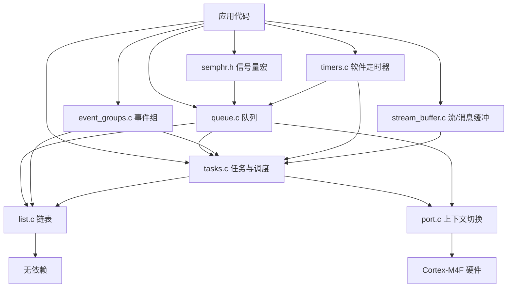
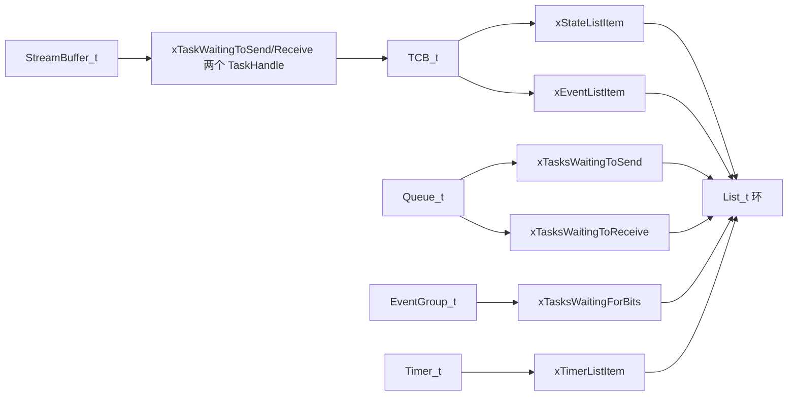
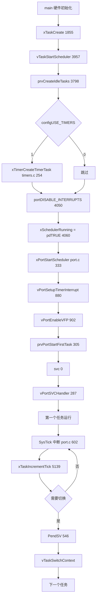
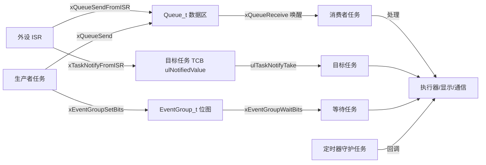
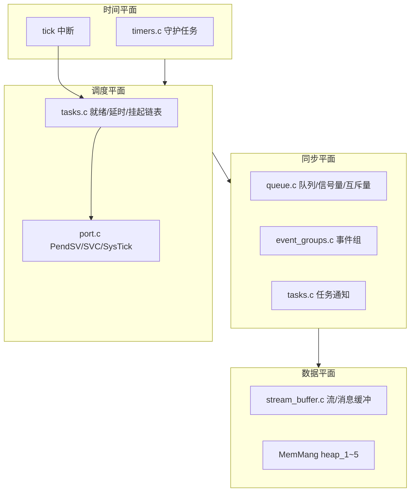

# FreeRTOS 内核源码详解 00：内核总览与读码地图

> **涉及文件（真实路径，行号以本仓库为准）：**
> - `tasks.c`（9398 行）、`queue.c`（3369 行）、`list.c`（568 行）、`timers.c`（1391 行）
> - `event_groups.c`（928 行）、`stream_buffer.c`（1796 行）、`croutine.c`（435 行）
> - `include/FreeRTOS.h`（3354 行）、`include/task.h`（3557 行）、`include/queue.h`（1752 行）
> - `portable/GCC/ARM_CM4F/port.c`（972 行）、`portmacro.h`（272 行）
> - `portable/MemMang/heap_1.c`（185 行）~ `heap_5.c`（803 行）
>
> **版本基准：** `History.txt` 第 3 行标注 "Changes between FreeRTOS V11.3.0 and FreeRTOS V11.3.1 released August 2026"，`include/FreeRTOS.h` 头部为 `<DEVELOPMENT BRANCH>`。
>
> **重要：** 本仓库的 `tasks.c`、`queue.c`、`FreeRTOS.h` 等文件已插入中文注释，**行号与上游 FreeRTOS-Kernel 不一致**。本文及 KB 所有行号均按当前工作区文件核对。

---

## 1. 仓库长什么样

### 1.1 顶层布局

| 路径 | 内容 | 读不读 |
|---|---|---|
| `*.c`（根目录） | 7 个内核源文件 | 精读 5 个（tasks/queue/list/timers/event_groups） |
| `include/` | 24 个头文件 | 查声明与宏时读 |
| `portable/GCC/ARM_CM4F/` | Cortex-M4F 移植层 | 精读 port.c 的上下文切换与 SysTick |
| `portable/MemMang/` | heap_1~heap_5 | 选一个读透 |
| `portable/` 其它目录 | 几十种架构/编译器移植层 | 只作对照，不读 |
| `examples/` | 模板配置与 CMake 示例 | 查 `FreeRTOSConfig.h` 写法 |
| `History.txt` | 版本变更 | 确认版本 |

**注意：本仓库没有 `source/` 目录。** 上游发布包的结构是 `FreeRTOS/Source/*.c` + `FreeRTOS/Source/include`；本仓库把 `Source/` 的内容直接放在根目录，所以读码时不要去找 `source/tasks.c`。

### 1.2 内核文件规模与职责

| 文件 | 行数 | 一句话职责 | 依赖 |
|---|---|---|---|
| `tasks.c` | 9398 | 任务创建/删除/挂起、调度器、tick、优先级继承、任务通知 | list.c、portmacro |
| `queue.c` | 3369 | 队列、信号量、互斥量、队列集、队列注册表 | tasks.c、list.c |
| `list.c` | 568 | 双向环形链表（哨兵），全内核的"排队"基础设施 | 无 |
| `timers.c` | 1391 | 软件定时器与守护任务、定时器命令队列 | queue.c、tasks.c |
| `event_groups.c` | 928 | 事件组（24 位位图 + AND/OR 等待） | tasks.c、list.c |
| `stream_buffer.c` | 1796 | 流缓冲 + 消息缓冲（环形字节区 + 任务通知唤醒） | tasks.c（通知） |
| `croutine.c` | 435 | 协程（已边缘化，仅保留兼容） | list.c |

**读码投入产出比：** `list.c` 200 行核心代码 → 支撑全部模块；`tasks.c` 9000 行里真正的主线约 1500 行，其余是 SMP/MPU/统计的条件编译。

### 1.3 头文件的角色

| 头文件 | 行数 | 作用 |
|---|---|---|
| `FreeRTOS.h` | 3354 | 汇总子头、给所有 `config*` 提供默认值、合法性检查 |
| `task.h` | 3557 | TCB 句柄、任务 API、临界区/让出宏 |
| `queue.h` | 1752 | 队列/信号量 API、`QueueHandle_t` |
| `semphr.h` | 1095 | 信号量/互斥量宏（映射到 queue.c） |
| `timers.h` | 1231 | 软件定时器 API |
| `event_groups.h` | 748 | 事件组 API 与 24 位限制 |
| `stream_buffer.h` | 909 | 流缓冲 API |
| `message_buffer.h` | 655 | 消息缓冲宏（映射到 stream_buffer.c） |
| `list.h` | 501 | 链表结构、17 个访问宏 |
| `atomic.h` | 422 | 通用原子操作（临界区实现） |
| `projdefs.h` | 144 | `pdPASS`/`pdFAIL`/`errQUEUE_*` |
| `stack_macros.h` | 150 | 栈溢出检测宏 |

---

## 2. 模块依赖：谁调用谁



**读图要点：**

- `list.c` 是唯一没有依赖的模块，所以先读它。
- `tasks.c` 依赖移植层（`portYIELD`、`portENTER_CRITICAL`、`pxCurrentTCB`），但移植层也反过来引用 `pxCurrentTCB`——这是唯一的环，靠 `portmacro.h` 的宏和 `extern` 打破。
- `stream_buffer.c` **不依赖 queue.c**，这是它比队列轻的原因（用任务通知而不是事件链表）。

### 2.1 数据结构依赖



**关键：** 除了 `StreamBuffer_t`，所有"等待"都落在 `list.c` 的环上；`StreamBuffer_t` 只有单等待者，所以直接存 `TaskHandle_t`。

---

## 3. 从 main 到第一个任务：启动时序

### 3.1 调用链

| 步骤 | 函数 | 位置 | 做了什么 |
|---|---|---|---|
| 1 | `xTaskCreate` | tasks.c:1855 | 分配 TCB + 栈，初始化栈帧 |
| 2 | `vTaskStartScheduler` | tasks.c:3957 | 创建 idle/timer 任务，启动移植层 |
| 3 | `prvCreateIdleTasks` | tasks.c:3798（调用 4018） | 每个核心一个 idle 任务，优先级 0 |
| 4 | `xTimerCreateTimerTask` | timers.c:254（调用 tasks.c:4024） | 创建守护任务 |
| 5 | `portDISABLE_INTERRUPTS` | tasks.c:4050 | 启动前关中断 |
| 6 | `xSchedulerRunning = pdTRUE` | tasks.c:4060 | 标记调度器运行 |
| 7 | `xPortStartScheduler` | port.c:333 | 配置 SysTick、FPU、启动第一个任务 |
| 8 | `vPortSetupTimerInterrupt` | port.c:880 | `reload = configSYSTICK_CLOCK_HZ / configTICK_RATE_HZ - 1` |
| 9 | `vPortEnableVFP` | port.c:902 | 置 CPACR 的 CP10/CP11 |
| 10 | `prvPortStartFirstTask` | port.c:305 | 设 MSP、`svc 0` |
| 11 | `vPortSVCHandler` | port.c:287 | 从 `pxCurrentTCB` 恢复第一个任务 |
| 12 | 第一个任务 | 用户函数 | 调度器开始运行 |

### 3.2 时序图



### 3.3 第一个任务的栈帧

`pxPortInitialiseStack`（port.c:224-258）伪造一个"刚从异常返回"的栈帧：

| 栈位置（从高到低） | 内容 | 行号 |
|---|---|---|
| 顶部 | `xPSR = 0x01000000` | 238 |
| ↓ | `PC = 任务入口 & ~1` | 240 |
| ↓ | `LR = prvTaskExitError` | 242 |
| ↓ | R12, R3, R2, R1（跳过） | 245 |
| ↓ | `R0 = pvParameters` | 246 |
| ↓ | `EXC_RETURN = 0xfffffffd` | 253 |
| ↓ | R11~R4（跳过） | 255 |
| 栈顶 | 返回的 `pxTopOfStack` | 257 |

**量化：** 初始栈帧占 **16 个字 = 64 字节**（不含 FPU 的 s16-s31）。这就是为什么 `configMINIMAL_STACK_SIZE = 128` 字（512 字节）只够空任务——光启动帧就吃掉 1/8。

---

## 4. 运行期数据流



**读图要点：**

- 中断到任务有两条主通道：队列（带数据、可缓冲）与任务通知（单值、零对象）。
- 事件组是"状态广播"：一个任务置位，多个任务各自等待。
- 软件定时器回调运行在守护任务上下文，不是中断。

---

## 5. KB 阅读顺序（18 条）

### 5.1 现有条目（10 条，禁改）

| # | 条目 | 主题 | 建议读法 |
|---|---|---|---|
| 1 | [freertos学习笔记.md](../../../05-学习笔记与知识库/Knowledge-Base/freertos/freertos学习笔记.md) | 总览笔记 | 先翻一遍建立术语 |
| 2 | [freertosconfigh.md](../../../05-学习笔记与知识库/Knowledge-Base/freertos/freertosconfigh.md) | 配置项 | 当字典查 |
| 3 | [list.md](../../../05-学习笔记与知识库/Knowledge-Base/freertos/list.md) | 链表 | **精读**，所有模块的地基 |
| 4 | [tasks.md](../../../05-学习笔记与知识库/Knowledge-Base/freertos/tasks.md) | 任务与调度 | **精读**，最核心 |
| 5 | [queue.md](../../../05-学习笔记与知识库/Knowledge-Base/freertos/queue.md) | 队列 | **精读** |
| 6 | [semphr.md](../../../05-学习笔记与知识库/Knowledge-Base/freertos/semphr.md) | 信号量/互斥量 | 与 queue 对照读 |
| 7 | [event_groups.md](../../../05-学习笔记与知识库/Knowledge-Base/freertos/event_groups.md) | 事件组 | 选读 |
| 8 | [stream_buffer.md](../../../05-学习笔记与知识库/Knowledge-Base/freertos/stream_buffer.md) | 流缓冲 | 选读 |
| 9 | [timers.md](../../../05-学习笔记与知识库/Knowledge-Base/freertos/timers.md) | 软件定时器 | 选读 |
| 10 | [port_cortex_m4f.md](../../../05-学习笔记与知识库/Knowledge-Base/freertos/port_cortex_m4f.md) | 移植层 | **精读**，配合 port.c |

> 注：任务清单写"已有 11 条"，实际目录内为上述 10 个 `.md` 文件（`ls` 可复核）。本文按实际文件数统计。

### 5.2 本次新增（8 条）

| # | 条目 | 主题 | 与现有条目的关系 |
|---|---|---|---|
| 11 | [semphr.md](../../../05-学习笔记与知识库/Knowledge-Base/freertos/semphr.md) | 信号量/互斥量/优先级继承 | 补 queue.md 未展开的互斥量部分 |
| 12 | [heap.md](../../../05-学习笔记与知识库/Knowledge-Base/freertos/heap.md) | 五种堆方案 | 补 freertosconfigh.md 的 `configTOTAL_HEAP_SIZE` |
| 13 | [message_buffer.md](../../../05-学习笔记与知识库/Knowledge-Base/freertos/message_buffer.md) | 消息缓冲 | 补 stream_buffer.md 的"消息 vs 流" |
| 14 | [task_notification.md](../../../05-学习笔记与知识库/Knowledge-Base/freertos/task_notification.md) | 任务通知 | 补 tasks.md 的通知段 |
| 15 | [cmsis_os2.md](../../../05-学习笔记与知识库/Knowledge-Base/freertos/cmsis_os2.md) | CMSIS-RTOS2 映射 | 应用层视角，非本仓库代码 |
| 16 | [atomic_and_portmacro.md](../../../05-学习笔记与知识库/Knowledge-Base/freertos/atomic_and_portmacro.md) | 原子操作/临界区 | 补 port_cortex_m4f.md 的 BASEPRI 细节 |
| 17 | [hooks.md](../../../05-学习笔记与知识库/Knowledge-Base/freertos/hooks.md) | 五种 Hook | 补 tasks.c 的回调点 |
| 18 | [event_groups_vs_queue.md](../../../05-学习笔记与知识库/Knowledge-Base/freertos/event_groups_vs_queue.md) | 选型指南 | 横向对比，最后读 |

### 5.3 五阶段阅读路线

```text
第 1 阶段（地基，2 小时）
  list.md → tasks.md 第 1~3 部分
  目标：能画出 TCB、就绪表、延时表、事件表的关系

第 2 阶段（同步，3 小时）
  queue.md → semphr.md → event_groups.md → event_groups_vs_queue.md
  目标：能回答"为什么信号量是 itemSize=0 的队列"

第 3 阶段（缓冲与通知，2 小时）
  stream_buffer.md → message_buffer.md → task_notification.md
  目标：能说清三种"传递"的边界与成本

第 4 阶段（系统服务，1.5 小时）
  timers.md → croutine.md（可跳过）
  目标：知道定时器回调在哪个任务里跑

第 5 阶段（移植与配置，2 小时）
  port_cortex_m4f.md → atomic_and_portmacro.md → hooks.md → heap.md → cmsis_os2.md
  目标：能改 FreeRTOSConfig.h 并解释每个宏的后果
```

---

## 6. 读码方法：这份仓库的四个特殊性

### 6.1 行号与上游不同

`tasks.c` 已插入大量中文注释（例如 `pxCurrentTCB` 定义处、`xTaskCreate` 函数头），导致行号整体后移。**任何"上游第 5000 行"的说法在这里都不成立**。本文所有行号用 `grep -n` 现场核对，例如：

```bash
grep -n "BaseType_t xTaskIncrementTick" tasks.c      # 5139
grep -n "void vTaskSwitchContext" tasks.c            # 需按实际文件查
```

### 6.2 条件编译分支极多

同一个函数常有 `configNUMBER_OF_CORES == 1` / `> 1`、`portUSING_MPU_WRAPPERS`、`configUSE_QUEUE_SETS` 等多份实现。**先确认当前配置走哪一支**，否则会把 SMP 代码当主线读。

推荐顺序：先读 `#if ( configNUMBER_OF_CORES == 1 )` 的单核分支，再看 `#else` 的 SMP 差异。

### 6.3 大量代码是"文档注释"

`task.h` 3557 行里超过一半是 Doxygen 注释；`tasks.c` 的函数实现反而很短。**读 API 语义看头文件，读实现看 .c**，不要从头到尾读头文件。

### 6.4 命名约定

| 前缀 | 含义 | 例子 |
|---|---|---|
| `x` | 返回 `BaseType_t`/句柄 | `xTaskCreate` |
| `v` | 返回 void | `vTaskDelete` |
| `ux` | 返回 `UBaseType_t` | `uxTaskPriorityGet` |
| `ul` | 返回 `unsigned long` | `ulTaskNotifyTake` |
| `prv` | 文件私有 static | `prvIdleTask` |
| `FromISR` | 中断安全版本 | `xQueueSendFromISR` |

---

## 7. 一张图总结：内核的四个平面



**读码时始终问自己：这个函数属于哪个平面？它改的是链表、计数器，还是数据区？** 把 9000 行的 tasks.c 拆成这四个平面，复杂度会下降一个数量级。
