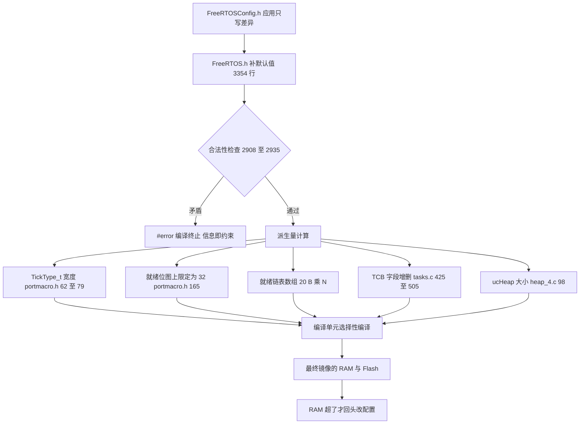
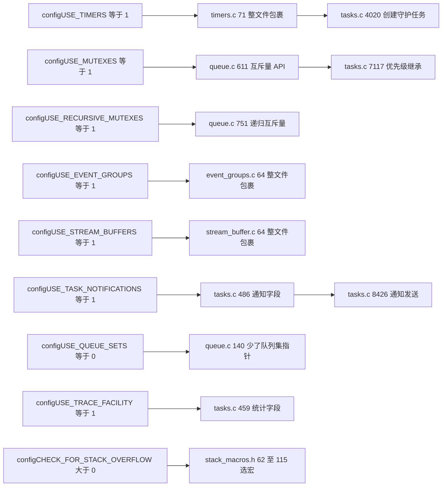

# FreeRTOS 源码详解 01：FreeRTOSConfig.h 配置项全景

> **涉及文件（真实路径，行号以本仓库为准）：**
> - `examples/template_configuration/FreeRTOSConfig.h`（675 行，本文"模板值"的来源）
> - `include/FreeRTOS.h`（3354 行，全部默认值与合法性检查都在这里）
> - `tasks.c`（9398 行）、`queue.c`（3369 行）、`timers.c`（1391 行）、`event_groups.c`（928 行）、`stream_buffer.c`（1796 行）
> - `portable/GCC/ARM_CM4F/portmacro.h`（272 行）、`portable/GCC/ARM_CM4F/port.c`（972 行）
> - `portable/MemMang/heap_1.c` ~ `heap_5.c`（heap_4.c 682 行）
>
> **版本基准：** `History.txt` 第 3 行为 "Changes between FreeRTOS V11.3.0 and FreeRTOS V11.3.1 released August 2026"，`include/FreeRTOS.h` 第 2 行为 `<DEVELOPMENT BRANCH>`。
>
> **路径提醒：** 本仓库没有 `Source/` 目录——上游发布包的 `Source/*.c` 与 `Source/include` 被摊平到了仓库根。所以"`Source/include/FreeRTOS.h`"在这一份工作区里就是 `include/FreeRTOS.h`。
>
> **姊妹篇：** [00-内核总览与读码地图.md](00-内核总览与读码地图.md)（模块依赖）、[02-移植层要点.md](02-移植层要点.md)（`configMAX_SYSCALL_INTERRUPT_PRIORITY` 怎么被用掉）、[03-常见设计模式与陷阱.md](03-常见设计模式与陷阱.md)（配置选错的后果）。
>
> **KB 对照：** [freertosconfigh.md](../../../05-学习笔记与知识库/Knowledge-Base/freertos/freertosconfigh.md)（逐项讲解与三平台差异）、[hooks.md](../../../05-学习笔记与知识库/Knowledge-Base/freertos/hooks.md)（配置为 1 之后要写哪个函数）。

---

## 1. 三层结构：谁给默认值，谁负责报错

FreeRTOS 的配置不是一个文件说了算，而是三层叠加：

| 层 | 文件 | 职责 | 写错的后果 |
|---|---|---|---|
| 1 应用配置 | `FreeRTOSConfig.h` | 只写"我想改成什么" | 缺必填项 → `#error` |
| 2 默认值层 | `include/FreeRTOS.h` | 给每个可选项补 `#ifndef ... #define` | 补不上才有默认 |
| 3 一致性检查 | `include/FreeRTOS.h` 2908~2935 等 | 两个宏互相矛盾时 `#error` | 编译期就炸，不会带到运行期 |

**读法：** 查"这个宏默认是什么"永远看 `include/FreeRTOS.h`，不要看模板（模板会显式写出全部宏，看不出默认值）。

### 1.1 节拍宽度：一个"二选一"的写法

`include/FreeRTOS.h:60-66`：

```c
#if !defined( configUSE_16_BIT_TICKS ) && !defined( configTICK_TYPE_WIDTH_IN_BITS )
    #error Missing definition:  One of configUSE_16_BIT_TICKS and configTICK_TYPE_WIDTH_IN_BITS must be defined in FreeRTOSConfig.h.  See the Configuration section of the FreeRTOS API documentation for details.
#endif

#if defined( configUSE_16_BIT_TICKS ) && defined( configTICK_TYPE_WIDTH_IN_BITS )
    #error Only one of configUSE_16_BIT_TICKS and configTICK_TYPE_WIDTH_IN_BITS must be defined in FreeRTOSConfig.h.  See the Configuration section of the FreeRTOS API documentation for details.
#endif
```

紧接着 `include/FreeRTOS.h:71-77` 把老宏翻译成新宏：

```c
#ifndef configTICK_TYPE_WIDTH_IN_BITS
    #if ( configUSE_16_BIT_TICKS == 1 )
        #define configTICK_TYPE_WIDTH_IN_BITS    TICK_TYPE_WIDTH_16_BITS
    #else
        #define configTICK_TYPE_WIDTH_IN_BITS    TICK_TYPE_WIDTH_32_BITS
    #endif
#endif
```

**设计意图：** `configUSE_16_BIT_TICKS` 是 V8 之前的名字，新代码用 `configTICK_TYPE_WIDTH_IN_BITS`（可选 16/32/64 三档，常量在 `FreeRTOS.h:53-55`）。两个都写会 `#error`，一个都不写也 `#error`——**没有默认值**，这是少数几个强制应用表态的配置。

**连锁反应：** 宽度决定 `TickType_t` 的 typedef，而 `portmacro.h:62-79` 只有在 32 位时才定义 `portTICK_TYPE_IS_ATOMIC 1`；一旦不是 32 位，`FreeRTOS.h:2941-2950` 会把读 tick 的宏改成真临界区，**每次读系统时间都要关中断**。

### 1.2 必填项（有 `#error` 看守的 6 个）

| 宏 | 检查位置 | 缺失/非法时的报错 |
|---|---|---|
| `configMINIMAL_STACK_SIZE` | `FreeRTOS.h:179` | "defines the size (in words) of the stack allocated to the idle task" |
| `configMAX_PRIORITIES` | `FreeRTOS.h:183`、下限 `187` | 必须 ≥ 1 |
| `configUSE_PREEMPTION` | `FreeRTOS.h:191` | 必须显式为 0 或 1 |
| `configUSE_IDLE_HOOK` | `FreeRTOS.h:195` | 必须显式为 0 或 1 |
| `configUSE_TICK_HOOK` | `FreeRTOS.h:205` | 必须显式为 0 或 1 |
| `configTICK_TYPE_WIDTH_IN_BITS` 或 `configUSE_16_BIT_TICKS` | `FreeRTOS.h:60` | 二选一 |

另有 4 个**没有看守、但少一个就编译不过或行为错误**的宏：

| 宏 | 被谁直接用 | 不定义的后果 |
|---|---|---|
| `configCPU_CLOCK_HZ` | `portmacro.h`/`port.c:133`、`887`、`896` | 编译错误（SysTick 重装载算不出来） |
| `configTICK_RATE_HZ` | `portmacro.h:84`、`port.c:885`、`896` | 编译错误 |
| `configMAX_SYSCALL_INTERRUPT_PRIORITY` | `portmacro.h:227`、`244`（汇编立即数） | 编译错误，且它是 BASEPRI 的阈值 |
| `configTOTAL_HEAP_SIZE` | `heap_1.c:73`、`heap_4.c:98` 的 `ucHeap[]` | 链接错误（数组长度未定义） |

---

## 2. 分类总表

表格约定：**默认值**一列写 `include/FreeRTOS.h`（或注明其它文件）的兜底值，括号里是行号；**模板值**一列取 `examples/template_configuration/FreeRTOSConfig.h`。

### 2.1 调度与时间

| 宏 | 默认值 | 模板值 | 影响 | 依赖 |
|---|---|---|---|---|
| `configUSE_PREEMPTION` | 无（`191` 必填） | 1 | 0 = 协作式，只有阻塞/让出/中断才切换 | 与 `configUSE_TASK_PREEMPTION_DISABLE` 有互斥检查（`2921`） |
| `configUSE_TIME_SLICING` | 1（`2786`） | 0 | 1 = 同优先级任务每 tick 轮转一次 | 仅在抢占式下有意义 |
| `configUSE_PORT_OPTIMISED_TASK_SELECTION` | 0（`2818`），但 `portmacro.h:148-150` 把它改成 1 | 0 | 用 `CLZ` 指令 O(1) 找最高优先级 | 要求 `configMAX_PRIORITIES ≤ 32`（`portmacro.h:165-167`） |
| `configTICK_RATE_HZ` | 无 | 100 | 1 tick = 10 ms；`portTICK_PERIOD_MS` 的除数 | SysTick 重装载 `port.c:896` |
| `configTICK_TYPE_WIDTH_IN_BITS` | 由 `configUSE_16_BIT_TICKS` 推导（`71-77`） | 32 位 | `TickType_t` 宽度、`portMAX_DELAY` 取值 | 32 位才有 `portTICK_TYPE_IS_ATOMIC`（`portmacro.h:73`） |
| `configMAX_PRIORITIES` | 无（`183`） | 5 | 就绪链表数组长度，**每级 20 B RAM** | 与位图优化上限 32 冲突 |
| `configMINIMAL_STACK_SIZE` | 无（`179`） | 128 | idle 任务栈，单位 **word** 不是 byte | 128 words = 512 B |
| `configMAX_TASK_NAME_LEN` | 16（`374`） | 16 | TCB 里 `pcTaskName[]` 的长度 | 每加 4 字符 +4 B × 任务数 |
| `configIDLE_SHOULD_YIELD` | 1（`378`） | 1 | 1 = idle 见到优先级 0 的应用任务立刻让出 | 影响 CPU 占用率统计 |
| `configUSE_TICKLESS_IDLE` | 0（`2754`） | 0 | 1 = 空闲时停 tick，`portSUPPRESS_TICKS_AND_SLEEP` 生效 | 需移植层实现 `vPortSuppressTicksAndSleep`（`port.c:634`） |
| `configEXPECTED_IDLE_TIME_BEFORE_SLEEP` | 2（`2746`） | 未设 | 至少空闲几个 tick 才允许睡眠 | 硬性下限 2（`2749`） |
| `configINITIAL_TICK_COUNT` | 0（`2938`） | 未设 | 调度器启动时的 `xTickCount` | 不改变 `xTaskGetTickCount` 单调性 |
| `configUSE_TASK_PREEMPTION_DISABLE` | 0（`362`） | 0 | 允许单任务临时关抢占（**仅 SMP**） | 单核下 `#error`（`2925`） |

### 2.2 内存与数据结构

| 宏 | 默认值 | 模板值 | 影响 | 依赖 |
|---|---|---|---|---|
| `configSUPPORT_STATIC_ALLOCATION` | 0（`2857`） | 1 | 编译 `xTaskCreateStatic` / `xQueueCreateStatic` 系列 | 与 dynamic 不能同时为 0（`2909`） |
| `configSUPPORT_DYNAMIC_ALLOCATION` | 1（`2866`） | 1 | 编译 `xTaskCreate` / `xQueueCreate` 系列 | 同上 |
| `configTOTAL_HEAP_SIZE` | 无（`heap_*.c` 直接用作数组长度） | 4096 | `ucHeap[]` 字节数，落在 `.bss` | 只对 heap_1/2/4/5 有效 |
| `configAPPLICATION_ALLOCATED_HEAP` | 0（`2822`） | 0 | 1 = 应用自己定义 `ucHeap[]`，可指定段 | 与 `configTOTAL_HEAP_SIZE` 配合 |
| `configSTACK_DEPTH_TYPE` | `StackType_t`（`2888`） | `size_t` | `xTaskCreate` 栈参数的类型 | 32 位下都是 4 B，无实质差别 |
| `configMESSAGE_BUFFER_LENGTH_TYPE` | `size_t`（`2905`） | `size_t` | 消息缓冲里"长度"字段的宽度 | 改成 `uint8_t` 可省 3 B/条 |
| `configENABLE_HEAP_PROTECTOR` | 0（`2826`） | 0 | heap_4/5 的块指针异或混淆 + 边界校验 | 每次分配多几条指令 |
| `configHEAP_CLEAR_MEMORY_ON_FREE` | 0（`heap_4.c:54-56`） | 1 | `vPortFree` 后按块大小清零 | 只对 heap_2/4/5 有效 |
| `configUSE_MINI_LIST_ITEM` | 1（`613`） | 1 | 哨兵节点少 3 个字段，省 12 B/链表 | 1 = 违反严格别名，靠编译器兼容 |
| `configUSE_LIST_DATA_INTEGRITY_CHECK_BYTES` | 无 `#ifndef`，未定义时按 0 | 未设 | 每个 `ListItem_t` 前后加校验字（+8 B） | 只在 `list.c` 的检查宏里生效 |

**量化：** `List_t`（`include/list.h:173-180`）= `uxNumberOfItems` 4 + `pxIndex` 4 + `MiniListItem_t` 12 = **20 B**；`ListItem_t`（`include/list.h:133-142`）= 5 个字段 = **20 B**。`configMAX_PRIORITIES = 5` 时，光 `pxReadyTasksLists[]`（`tasks.c:531`）就占 5 × 20 = **100 B**。

### 2.3 IPC 与内核对象

| 宏 | 默认值 | 模板值 | 影响 | 依赖 |
|---|---|---|---|---|
| `configUSE_MUTEXES` | 0（`332`） | 1 | 互斥量 + 优先级继承；TCB 多 2 个字段 | 递归互斥量的前置（`2913`） |
| `configUSE_RECURSIVE_MUTEXES` | 0（`328`） | 1 | 递归互斥量（引用计数存在队列里） | 必须 `configUSE_MUTEXES = 1` |
| `configUSE_COUNTING_SEMAPHORES` | 0（`358`） | 1 | 计数信号量 | 无 |
| `configUSE_QUEUE_SETS` | 0（`2770`） | 0 | `Queue_t` 多一个 `pxQueueSetContainer` 指针 | 每队列 +4 B |
| `configUSE_TIMERS` | 0（`336`） | 1 | 编译 `timers.c`，启动时创建守护任务 | 还需要 3 个 `configTIMER_*`（`536`、`540`、`544`） |
| `configTIMER_TASK_PRIORITY` | 无（`TIMERS=1` 时必填 `536`） | `MAX_PRIORITIES-1` | 守护任务优先级 | 回调在此优先级上跑 |
| `configTIMER_QUEUE_LENGTH` | 无（`540`） | 10 | 定时器命令队列长度 | 满了 `xTimerStart` 会失败 |
| `configTIMER_TASK_STACK_DEPTH` | 无（`544`） | `MINIMAL_STACK_SIZE` | 守护任务栈（word） | 回调里用栈也算它 |
| `configUSE_EVENT_GROUPS` | 1（`340`） | 1 | 编译 `event_groups.c`（`event_groups.c:64` 整体包裹） | 无 |
| `configUSE_STREAM_BUFFERS` | 1（`344`） | 1 | 编译 `stream_buffer.c`（`stream_buffer.c:64`） | 无 |
| `configUSE_TASK_NOTIFICATIONS` | 1（`2830`） | 1 | TCB 里每索引 4 B 值 + 1 B 状态 | 关掉后所有 `xTaskNotify*` 消失 |
| `configTASK_NOTIFICATION_ARRAY_ENTRIES` | 1（`2834`） | 1 | 每任务可挂几组通知 | 下限 1（`2837`） |
| `configQUEUE_REGISTRY_SIZE` | 0（`603`） | 0 | >0 才编译注册表，供内核感知调试器 | =0 时 API 被宏抹成空（`606-610`） |
| `configUSE_SB_COMPLETED_CALLBACK` | 0（`2848`） | 0 | 流/消息缓冲的 per-instance 收发完成回调 | 无 |

### 2.4 调试、断言与统计

| 宏 | 默认值 | 模板值 | 影响 | 依赖 |
|---|---|---|---|---|
| `configASSERT` | 空宏（`98-100`） | 关中断死循环（模板 `420-426`） | 定义后 `configASSERT_DEFINED = 1`，全内核的 `configASSERT` 才开始生效 | `configCHECK_HANDLER_INSTALLATION = 1` 要求它存在（`410-412`） |
| `configCHECK_HANDLER_INSTALLATION` | 1（`403`） | 1 | 启动时校验向量表里装的是不是 `vPortSVCHandler`/`xPortPendSVHandler`（`port.c:372-373`） | 间接路由（自己转发）时必须设 0 |
| `configCHECK_FOR_STACK_OVERFLOW` | 0（`730`） | 2 | 1 = 比栈顶指针；2 = 再查栈尾 `0xa5` 图案 | 需实现 `vApplicationStackOverflowHook` |
| `configRECORD_STACK_HIGH_ADDRESS` | 0（`734`） | 未设 | TCB 记录 `pxEndOfStack` | 调试器看栈范围需要 |
| `configUSE_MALLOC_FAILED_HOOK` | 0（`95`） | 0 | `pvPortMalloc` 失败时回调 | 需实现 `vApplicationMallocFailedHook` |
| `configGENERATE_RUN_TIME_STATS` | 0（`2712`） | 0 | 每任务累计运行时间；TCB +4 B | 需 `portCONFIGURE_TIMER_FOR_RUN_TIME_STATS` + `portGET_RUN_TIME_COUNTER_VALUE`（`2717-2725`） |
| `configUSE_TRACE_FACILITY` | 0（`2802`） | 0 | TCB +8 B（`uxTCBNumber`/`uxTaskNumber`），暴露 `uxTaskGetSystemState` | `vTaskList` 的前置 |
| `configUSE_STATS_FORMATTING_FUNCTIONS` | 0（`2794`） | 0 | 编译 `vTaskList`/`vTaskGetRunTimeStats`（依赖 `sprintf`） | 必须 `TRACE` 或 `RUN_TIME_STATS` 之一（`2873-2877`） |
| `configSTATS_BUFFER_MAX_LENGTH` | `0xFFFF`（`2880`） | `0xFFFF` | 老 API 假定调用者缓冲区多大 | 新 API 显式传长度，不受此限 |
| `configUSE_CO_ROUTINES` | 0（`216`） | 0 | 编译 `croutine.c` | 需 `configMAX_CO_ROUTINE_PRIORITIES`（`313-317`） |

### 2.5 可选 API（`INCLUDE_*`）

默认值一律 0，例外只有 `INCLUDE_xTaskGetCurrentTaskHandle`（`FreeRTOS.h:309-311` 默认 1，因为内核自己要用）。

| 宏 | 默认 | 模板 | 不打开的后果 |
|---|---|---|---|
| `INCLUDE_vTaskDelete` | 0 | 1 | 不能删任务，`vTaskDelete(NULL)` 自删也没有 |
| `INCLUDE_vTaskDelay` | 0 | 1 | 不能相对延时 |
| `INCLUDE_xTaskDelayUntil` | 0（`257`） | 1 | 不能周期延时 |
| `INCLUDE_vTaskSuspend` | 0 | 1 | 不能挂起/恢复；`portMAX_DELAY` 语义也变（见 3.4 的解析） |
| `INCLUDE_uxTaskGetStackHighWaterMark` | 0 | 0（模板显式关） | 不能查栈水位，调栈大小只能靠猜 |
| `INCLUDE_xTaskGetSchedulerState` | 0 | 1 | `include/FreeRTOS.h:533` 的注释已说明定时器模块依赖它 |
| `INCLUDE_eTaskGetState` | 0 | 0 | 不能查任务状态 |
| `INCLUDE_xTaskAbortDelay` | 0 | 0 | 不能提前打断 `vTaskDelay` |
| `INCLUDE_xTaskGetHandle` | 0 | 0 | 不能按名字找 TCB |
| `INCLUDE_xTimerPendFunctionCall` | 0 | 0 | 不能把函数甩给守护任务；**`xEventGroupSetBitsFromISR` 也会消失**（`event_groups.c:866` 就是靠它实现） |

**兼容别名：** `INCLUDE_vTaskDelayUntil` 已被 `INCLUDE_xTaskDelayUntil` 取代，两个同时定义会 `#error`（`FreeRTOS.h:235-243`）；只写老的会自动映射（`245-255`）。

### 2.6 移植层与中断优先级

| 宏 | 默认值 | 模板值 | 影响 | 依赖 |
|---|---|---|---|---|
| `configCPU_CLOCK_HZ` | 无 | 20000000 | `configSYSTICK_CLOCK_HZ` 的兜底（`port.c:132-139`） | 必须等于驱动 SysTick 的时钟 |
| `configSYSTICK_CLOCK_HZ` | 未定义 → 取 `configCPU_CLOCK_HZ` | 未设 | SysTick 独立时钟源时使用 | 定义后 CLK 位改选外部参考（`port.c:138`） |
| `configMAX_SYSCALL_INTERRUPT_PRIORITY` | 无 | 0（模板）/ 典型 `5 << 4 = 0x50` | BASEPRI 阈值：数值 ≥ 它的中断被临界区屏蔽 | 必须是 `port.c:597` 汇编里的**立即数**；`port.c:416` 校验未实现位为 0 |
| `configKERNEL_INTERRUPT_PRIORITY` | 本移植层不使用 | 0 | Cortex-M4F 端口直接写 SHPR：SVCall 为 0、PendSV/SysTick 为 255（`port.c:471-473`） | 其它端口才用 |
| `configTASK_RETURN_ADDRESS` | 未定义 → `prvTaskExitError`（`port.c:145-149`） | 未设 | 任务入口返回时落到哪 | 调试器栈回溯时有用 |
| `portSTACK_LIMIT_PADDING` | 0（`include/stack_macros.h:49`） | 未设 | 栈溢出判定留多少字余量 | 配合 `configCHECK_FOR_STACK_OVERFLOW` |

### 2.7 SMP / MPU / ARMv8-M（本移植层不生效，列出来是为了"看到不认识的宏不慌"）

| 宏 | 默认值 | 说明 |
|---|---|---|
| `configNUMBER_OF_CORES` | 1（`90-92`） | >1 才编译 SMP 分支；单核下 `configUSE_TASK_PREEMPTION_DISABLE`、`configUSE_CORE_AFFINITY` 都会 `#error`（`2925-2931`） |
| `configRUN_MULTIPLE_PRIORITIES` | 0（`423-425`） | SMP 下是否允许不同优先级同时跑 |
| `configUSE_CORE_AFFINITY` | 0（`519-521`） | 核亲和性；单核 `#error` |
| `configUSE_MPU_WRAPPERS_V1` | 0（`80-82`） | MPU 封装 v1/v2 选择 |
| `configENABLE_ACCESS_CONTROL_LIST` | 0（`85-87`） | MPU v2 的 ACL |
| `configENABLE_PAC` / `configENABLE_BTI` | 0 / 0（`108-114`） | ARMv8.1-M 的指针认证/分支目标识别 |
| `configENABLE_TRUSTZONE` / `configENABLE_MPU` / `configENABLE_FPU` / `configENABLE_MVE` | 见 `3045-3075` | ARMv8-M 端口专用；Cortex-M4F 走 `vPortEnableVFP`（`port.c:902`） |

---

## 3. 五处真实的 `#if configXXX == 0` 精读

这一节全部是"两个配置互相矛盾时，编译期就拦住你"的例子。它们比文档有用，因为**报错信息本身就是设计约束**。

### 3.1 守护任务钩子必须有守护任务（`FreeRTOS.h:351-355`）

```c
#if ( configUSE_DAEMON_TASK_STARTUP_HOOK != 0 )
    #if ( configUSE_TIMERS == 0 )
        #error configUSE_DAEMON_TASK_STARTUP_HOOK is set, but the daemon task is not created because configUSE_TIMERS is 0.
    #endif
#endif
```

守护任务（daemon/timer service task）是 `timers.c` 创建的，`configUSE_TIMERS = 0` 时它根本不存在，钩子无处可挂。**这条检查把"钩子"和"任务存在性"绑在一起**，而不是等到链接期报 `undefined reference`。

### 3.2 静态/动态分配不能同时关（`FreeRTOS.h:2909-2911`）

```c
#if ( ( configSUPPORT_STATIC_ALLOCATION == 0 ) && ( configSUPPORT_DYNAMIC_ALLOCATION == 0 ) )
    #error configSUPPORT_STATIC_ALLOCATION and configSUPPORT_DYNAMIC_ALLOCATION cannot both be 0, but can both be 1.
#endif
```

两个都为 0 意味着"任何对象都创建不出来"，内核变成一堆不能实例化的函数。**两个都为 1 是合法的**——这也是本仓库模板的选择（模板 `276`、`284`）。

### 3.3 关抢占与"单任务关抢占"是两件事（`FreeRTOS.h:2921-2923`）

```c
#if ( ( configUSE_PREEMPTION == 0 ) && ( configUSE_TASK_PREEMPTION_DISABLE != 0 ) )
    #error configUSE_PREEMPTION must be set to 1 to use task preemption disable
#endif
```

`configUSE_PREEMPTION = 0` 是**全局协作式**；`configUSE_TASK_PREEMPTION_DISABLE` 是**让某个任务在抢占式系统里临时变协作**。后者以前者为前提，否则语义互相覆盖。

### 3.4 单核没有"给某个任务关抢占"（`FreeRTOS.h:2925-2927`）

```c
#if ( ( configNUMBER_OF_CORES == 1 ) && ( configUSE_TASK_PREEMPTION_DISABLE != 0 ) )
    #error configUSE_TASK_PREEMPTION_DISABLE is not supported in single core FreeRTOS
#endif
```

单核要"关抢占"直接用 `vTaskSuspendAll()`，不需要 per-task 开关。**这条 `== 1` 的判断是"单核"而不是"配置错误"，读代码时容易误判成 bug。**

### 3.5 位图优化与 SMP 不兼容（`FreeRTOS.h:2933-2935`）

```c
#if ( ( configNUMBER_OF_CORES > 1 ) && ( configUSE_PORT_OPTIMISED_TASK_SELECTION != 0 ) )
    #error configUSE_PORT_OPTIMISED_TASK_SELECTION is not supported in SMP FreeRTOS
#endif
```

`uxTopReadyPriority` 是**单核全局变量**（`portmacro.h:170-175` 的位图宏），SMP 下每个核都有自己的就绪视图，一个全局位图会串味。所以 SMP 强制回退到通用 C 算法（`tasks.c:284-289`）。

### 3.6 附带一处"配置直接把 API 抹掉"（`FreeRTOS.h:606-610`）

```c
#if ( configQUEUE_REGISTRY_SIZE < 1 )
    #define vQueueAddToRegistry( xQueue, pcName )
    #define vQueueUnregisterQueue( xQueue )
    #define pcQueueGetName( xQueue )
#endif
```

这不是 `#error`，而是把三个函数**变成空宏**。后果：`vQueueAddToRegistry(q, "name")` 能编译通过、也能链接、但什么也不做。**配置为 0 时调试器里永远看不到队列名字**，这是最容易被忽略的一类"静默裁剪"。

---

## 4. 配置如何决定裁剪



**读图要点：**

- 三条路径最终都落到"镜像体积"，但**只有 `configTOTAL_HEAP_SIZE` 是可精确预算的**，其余是乘任务数的线性项。
- `#error` 分支把问题挡在编译期；没有 `#error` 守护的宏（`configTOTAL_HEAP_SIZE`、`configCPU_CLOCK_HZ`）出问题时表现为**链接错误或运行期 HardFault**，排查成本高一个数量级。

## 5. `configUSE_*` 与源文件条件编译的对应关系



**读图要点：**

- `timers.c` / `event_groups.c` / `stream_buffer.c` 是**整文件包裹**：配置为 0 时整个 .c 编译成空对象，但**文件仍在工程里**（CMake 照样编译），不会报错。
- `queue.c` / `tasks.c` 是**分段包裹**：同一个文件里，互斥量、递归互斥量、队列集各占一段。所以"关掉 `configUSE_MUTEXES` 后 queue.c 变小"是真的，但 `queue.c` 不会消失。
- `stack_macros.h` 是**按配置选宏实现**（4 个版本：增长方向 × 检查级别），配置改变的是宏体而不是函数。

---

## 6. 量化：配置改动值多少字节、多少周期

### 6.1 TCB 尺寸手算（默认开关，单核，Cortex-M4F）

按 `tasks.c:425-505` 的字段顺序，取"`configMAX_TASK_NAME_LEN = 16`、`configUSE_MUTEXES = 1`、通知 1 组、静态+动态都开"：

| 字段 | 字节 |
|---|---|
| `pxTopOfStack` | 4 |
| `xStateListItem`（`ListItem_t`） | 20 |
| `xEventListItem`（`ListItem_t`） | 20 |
| `uxPriority` | 4 |
| `pxStack` | 4 |
| `pcTaskName[16]` | 16 |
| `uxBasePriority` + `uxMutexesHeld` | 8 |
| `ulNotifiedValue[1]` + `ucNotifyState[1]` | 5 |
| `ucStaticallyAllocated` | 1 |
| **合计（对齐到 4）** | **84** |

再加 heap_4 的块头 `xHeapStructSize`（`heap_4.c:161`，`BlockLink_t` 8 B 按 8 对齐）= **8 B**，一个任务的内核侧固定开销约 **92 B**（不含栈）。10 个任务 ≈ 920 B。

**开关的边际成本：**

| 打开 | 增加 |
|---|---|
| `configUSE_TRACE_FACILITY` | +8 B/任务 |
| `configGENERATE_RUN_TIME_STATS` | +4 B/任务 |
| `configUSE_QUEUE_SETS` | +4 B/队列 |
| `configUSE_LIST_DATA_INTEGRITY_CHECK_BYTES` | +8 B/`ListItem_t`，每任务 2 个 → +16 B/任务 |
| `configCHECK_FOR_STACK_OVERFLOW = 2` | 0 B，但每次切换多 4 次比较 |

### 6.2 优先级数量与查表成本

`configMAX_PRIORITIES = 32` 是**位图优化的硬上限**（`portmacro.h:165-167` 的 `#error`）。32 级时：

- 就绪链表数组：32 × 20 B = **640 B**；
- 选任务：`CLZ` 一条指令，**O(1)**（`portmacro.h:175`）；
- 超过 32 级：退回 `tasks.c:284-289` 的通用循环，**O(n)**，n = 优先级数。

### 6.3 ticking 成本

`configTICK_RATE_HZ = 1000` 时，SysTick 每 1 ms 进一次中断，`xTaskIncrementTick`（`tasks.c:5139`）至少做：读 `uxSchedulerSuspended`、自增 `xTickCount`、比较 `xNextTaskUnblockTime`。`1000 Hz` 意味着**每秒 1000 次这个开销**；`100 Hz` 降低 10 倍，但 `vTaskDelay(1)` 的粒度变成 10 ms。

**经验值：** 需要 `< 10 ms` 的定时精度就别用 `vTaskDelay`，用硬件定时器 + 通知；tick 只负责"到点唤醒"。

---

## 7. 陷阱与实测建议

1. **`configASSERT` 不定义 = 全部检查消失。** `FreeRTOS.h:98-100` 把它定义成空宏，`configASSERT_DEFINED = 0`。于是 `port.c:410`、`416`、`446`、`955` 这些"优先级配置合法性"检查全部不编译。**调试版一定要开**，量产版再关。
2. **`configMAX_SYSCALL_INTERRUPT_PRIORITY` 写错的表现是"偶发死机"而不是编译错误。** 它必须写成"已左移到高位的值"（4 位优先级时 `5 << 4 = 0x50`）。写 `5` 的含义是"屏蔽优先级 5~15 的全部中断"，`port.c:416` 的断言会抓到，但断言关掉后就只能在现场抓。
3. **`configMINIMAL_STACK_SIZE` 只管 idle 任务。** 名字里的 "MINIMAL" 会误导人以为它是全局下限——`tasks.c` 里除 idle 外没有任何地方用它。定时器守护任务用 `configTIMER_TASK_STACK_DEPTH`，应用任务各写各的。
4. **`configUSE_TIMERS = 1` 会凭空多一个任务和一条队列。** 守护任务栈 = `configTIMER_TASK_STACK_DEPTH` words，命令队列 = `configTIMER_QUEUE_LENGTH` 项。**没算进 RAM 预算就会在 `vTaskStartScheduler` 里 malloc 失败**（表现为 `vApplicationMallocFailedHook` 或直接不进调度器）。
5. **`configQUEUE_REGISTRY_SIZE = 0` 时注册 API 是空宏（`FreeRTOS.h:606-610`）。** 想用调试器看队列名，必须 ≥ 队列+信号量总数，且 `vQueueAddToRegistry` 要真的被调用。
6. **`configCHECK_FOR_STACK_OVERFLOW = 2` 依赖"创建任务时填 0xa5"（`tasks.c:1966`）。** 如果栈是静态分配且你手动 memset 过，图案被覆盖，检查会**误报**或**漏报**。
7. **`configUSE_PORT_OPTIMISED_TASK_SELECTION` 在 `portmacro.h:148-150` 被默认改成 1。** 也就是说 `FreeRTOS.h:2818` 的默认 0 对 Cortex-M4F **不成立**——移植层的 `#ifndef` 先执行。查默认值时要按"头文件包含顺序"看，不能只看 FreeRTOS.h。

**实测建议（按优先级）：**

```text
1. 先开 configASSERT + configCHECK_FOR_STACK_OVERFLOW=2 + configUSE_MALLOC_FAILED_HOOK=1 跑一周
2. 用 uxTaskGetStackHighWaterMark 采集真实水位，再统一把栈砍到 1.3 倍
3. 采集 uxTaskGetSystemState 的 CPU 占比，确认 idle 占比 > 20%
4. 最后才关断言、调 configTOTAL_HEAP_SIZE，并留 15% 余量
```

> 选型与后果的进一步讨论见 [03-常见设计模式与陷阱.md](03-常见设计模式与陷阱.md)；这些宏在移植层里怎么被消耗掉见 [02-移植层要点.md](02-移植层要点.md)。
