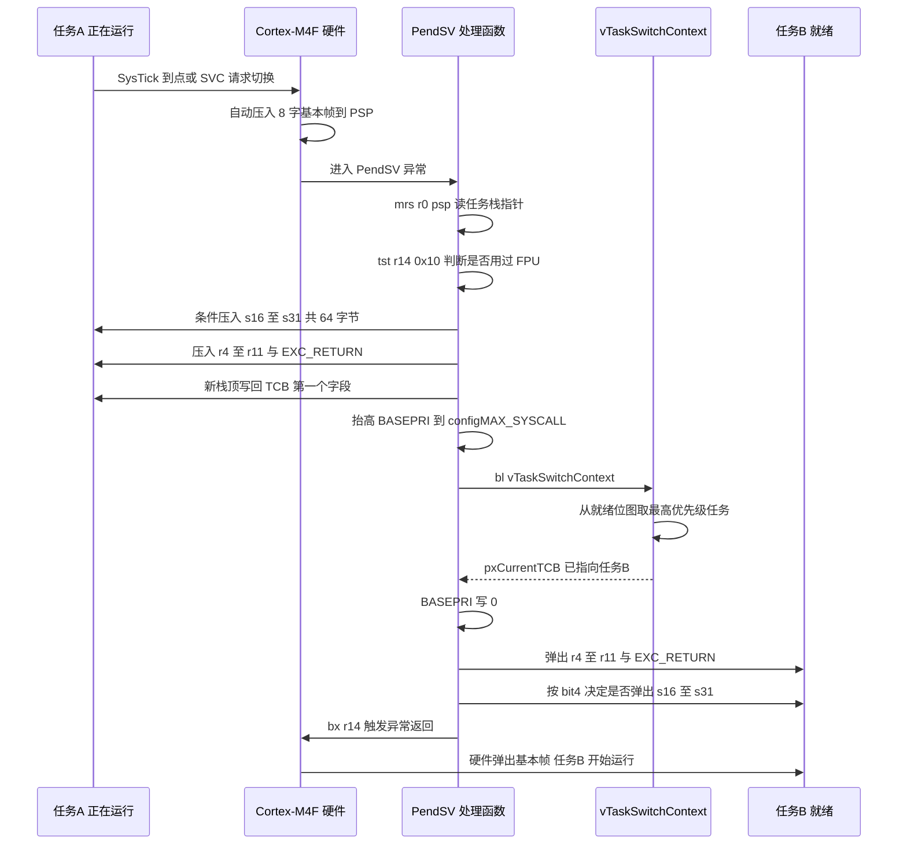
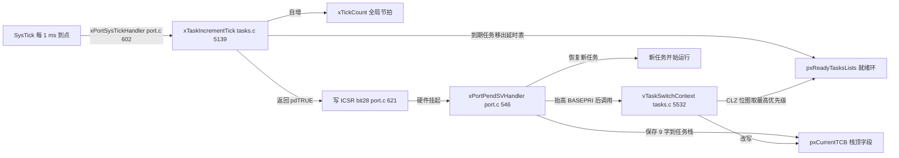

# FreeRTOS 源码详解 02：Cortex-M4F 移植层要点

> **涉及文件（真实路径，行号以本仓库为准）：**
> - `portable/GCC/ARM_CM4F/port.c`（972 行）、`portable/GCC/ARM_CM4F/portmacro.h`（272 行）
> - `tasks.c` 的 `xTaskIncrementTick`（5139）、`vTaskSwitchContext`（5532）；`include/FreeRTOS.h`（3354 行）
>
> **版本基准：** `History.txt` 第 3 行为 V11.3.0 → V11.3.1（2026-08），`include/FreeRTOS.h` 第 2 行为 `<DEVELOPMENT BRANCH>`。本仓库文件已插入中文注释，行号与上游不同。
>
> **姊妹篇：** [00-内核总览与读码地图.md](00-内核总览与读码地图.md)（启动链路）、[01-配置项全景.md](01-配置项全景.md)（宏定义与默认值）、[03-常见设计模式与陷阱.md](03-常见设计模式与陷阱.md)（中断延迟预算）。
>
> **KB 对照：** [port_cortex_m4f.md](../../../05-学习笔记与知识库/Knowledge-Base/freertos/port_cortex_m4f.md)（逐指令解读）、[atomic_and_portmacro.md](../../../05-学习笔记与知识库/Knowledge-Base/freertos/atomic_and_portmacro.md)（三层临界区）。

---

## 1. 三个异常，各管一件事

| 异常 | 编号 | 优先级 | 谁触发 | 干什么 | 位置 |
|---|---|---|---|---|---|
| SVCall | 11 | **0（最高）** | `svc 0` | 只在启动时用一次：从 TCB 恢复第一个任务 | `port.c:287` |
| PendSV | 14 | **255（最低）** | 写 ICSR 的 bit28 | 每次切换：存旧上下文、恢复新上下文 | `port.c:546` |
| SysTick | 15 | **255（最低）** | 计数到 0 | 递增 tick、必要时挂起 PendSV | `port.c:602` |

优先级设置（`port.c:467-473`）：

```c
    /*
     * 将 PendSV 和 SysTick 设为最低优先级中断，
     * 并将 SVCall 设为最高优先级。
     */
    portNVIC_SHPR3_REG |= portNVIC_PENDSV_PRI;
    portNVIC_SHPR3_REG |= portNVIC_SYSTICK_PRI;
    portNVIC_SHPR2_REG = 0;
```

`portNVIC_PENDSV_PRI` / `portNVIC_SYSTICK_PRI`（`port.c:83-85`）都是 `255 << 16/24`，即最低优先级。

**为什么这样排：** PendSV 要做完整切换（几十条指令），优先级高就会打断外设 ISR，把中断延迟推到十微秒级；放最低意味着**所有 ISR 跑完才轮到它**。SysTick 与它同级（255），互不抢占，且只做"记账 + 挂 PendSV"。SVCall 最高是因为它只在 `vTaskStartScheduler` 里用一次，此时还没有任务，高优先级不伤谁。

---

## 2. portmacro.h：七个必须记住的原语

### 2.1 节拍宽度（`portmacro.h:62-79`）

```c
#if ( configTICK_TYPE_WIDTH_IN_BITS == TICK_TYPE_WIDTH_16_BITS )
    typedef uint16_t     TickType_t;
    #define portMAX_DELAY              ( TickType_t ) 0xffff
#elif ( configTICK_TYPE_WIDTH_IN_BITS == TICK_TYPE_WIDTH_32_BITS )
    typedef uint32_t     TickType_t;
    #define portMAX_DELAY              ( TickType_t ) 0xffffffffUL
```

同一分支里还有一行（`73`）`#define portTICK_TYPE_IS_ATOMIC 1`。**只有 32 位节拍才敢声明读取原子**，于是 `FreeRTOS.h:2941-2959` 把 `portTICK_TYPE_ENTER_CRITICAL()` 定义成空宏——`xTaskGetTickCount()` 变成一条 `LDR`。16 位节拍时同一份代码要关中断，读一次时间几十个周期。

### 2.2 栈与对齐（`portmacro.h:83-86`）

```c
#define portSTACK_GROWTH      ( -1 )
#define portTICK_PERIOD_MS    ( ( TickType_t ) 1000 / configTICK_RATE_HZ )
#define portBYTE_ALIGNMENT    8
```

- `portSTACK_GROWTH = -1`：栈向下长，决定 `stack_macros.h` 用哪套溢出检查。
- `portBYTE_ALIGNMENT = 8`：AAPCS 要求，**FPU 的 8 字节 `double` 也依赖它**；只有 4 字节对齐时 `vstmdbeq` 会 UsageFault。
- `portTICK_PERIOD_MS` 是整数除法，要精确换算用 `pdMS_TO_TICKS`。

### 2.3 让出：只写一个位（`portmacro.h:90-102`）

```c
#define portYIELD()                                     \
    {                                                   \
        /* Set a PendSV to request a context switch. */ \
        portNVIC_INT_CTRL_REG = portNVIC_PENDSVSET_BIT; \
                                                        \
        /* Barriers are normally not required but do ensure the code is completely \
         * within the specified behaviour for the architecture. */ \
        __asm volatile ( "dsb" ::: "memory" );                     \
        __asm volatile ( "isb" );                                  \
    }
```

`portNVIC_INT_CTRL_REG` 是 `0xE000ED04`（ICSR），bit28 = `PENDSVSET`。写这一位 = 请求一次 PendSV，**不会立即切换**，要等当前异常/临界区退出。`dsb` 保证之前的数据访问完成，`isb` 冲刷流水线让异常立刻被识别。

### 2.4 中断屏蔽：BASEPRI 而不是 PRIMASK（`portmacro.h:120-127`）

```c
extern void vPortEnterCritical( void );
extern void vPortExitCritical( void );
#define portSET_INTERRUPT_MASK_FROM_ISR()         ulPortRaiseBASEPRI()
#define portCLEAR_INTERRUPT_MASK_FROM_ISR( x )    vPortSetBASEPRI( x )
#define portDISABLE_INTERRUPTS()                  vPortRaiseBASEPRI()
#define portENABLE_INTERRUPTS()                   vPortSetBASEPRI( 0 )
#define portENTER_CRITICAL()                      vPortEnterCritical()
#define portEXIT_CRITICAL()                       vPortExitCritical()
```

| 方案 | 屏蔽范围 | 中断延迟 | FreeRTOS |
|---|---|---|---|
| `cpsid i`（PRIMASK） | **全部**中断 | 取决于最长临界区，不可收敛 | 不用 |
| `BASEPRI = 阈值` | 只有数值 ≥ 阈值的较低优先级中断 | 高优先级中断**完全不受影响** | 用这个 |

所以 FreeRTOS 的"临界区"不是"关中断"，而是"关掉会调用 FreeRTOS API 的中断"。真正的硬实时中断（电机换相、过流保护）只要优先级数值**小于** `configMAX_SYSCALL_INTERRUPT_PRIORITY`，就永远不被临界区延迟——代价是**不能调用任何 `FromISR` API**。

### 2.5 抬高 BASEPRI（`portmacro.h:217-229`）

```c
portFORCE_INLINE static void vPortRaiseBASEPRI( void )
{
    uint32_t ulNewBASEPRI;

    __asm volatile
    (
        "   mov %0, %1                                              \n" \
        "   msr basepri, %0                                         \n" \
        "   isb                                                     \n" \
        "   dsb                                                     \n" \
        : "=r" ( ulNewBASEPRI ) : "i" ( configMAX_SYSCALL_INTERRUPT_PRIORITY ) : "memory"
    );
}
```

- `"i"`：阈值必须是**编译期立即数**，写变量或表达式编译失败。因为 `msr` 与 `isb` 之间不能插取数指令。
- `"=r"` 哑输出：给立即数一个落脚的寄存器，否则 `mov` 无目标。
- `"memory"` clobber：防止编译器把临界区内的访存提到外面。
- `isb` 在 `dsb` 之前：`msr` 是系统寄存器写，需 `isb` 同步指令流；`dsb` 保证之前的数据访问完成。

### 2.6 可嵌套版本（`portmacro.h:233-252`）

```c
        : "=r" ( ulOriginalBASEPRI ), "=r" ( ulNewBASEPRI ) : "i" ( configMAX_SYSCALL_INTERRUPT_PRIORITY ) : "memory"
```

比 2.5 多了 `mrs %0, basepri`（`239`）：**先存旧值再改**。旧值作为 `portSET_INTERRUPT_MASK_FROM_ISR()` 的返回值，由 `portCLEAR_INTERRUPT_MASK_FROM_ISR( x )` 恢复。

**为什么 ISR 里必须用它：** 一个 `FromISR` 函数可能被更高优先级 ISR 打断，那个 ISR 又调 `FromISR`。若无条件把 BASEPRI 清 0，外层的屏蔽就被破坏。保存/恢复让屏蔽可以嵌套。

### 2.7 恢复 BASEPRI（`portmacro.h:255-261`）

函数体只有一句 `"   msr basepri, %0 " ::"r" ( ulNewMaskValue ) : "memory"`（`portmacro.h:259`）。只写不读，也不需要 `isb`——它总在"退出临界区/退出 ISR"的上下文中，屏障由调用点负责。

---

## 3. port.c：启动链路

### 3.1 伪造一个"刚从异常返回"的栈帧（`port.c:224-258`）

```c
    pxTopOfStack--;

    *pxTopOfStack = portINITIAL_XPSR;                                    /* xPSR 寄存器 */
    pxTopOfStack--;
    *pxTopOfStack = ( ( StackType_t ) pxCode ) & portSTART_ADDRESS_MASK; /* PC 程序计数器 */
    pxTopOfStack--;
    *pxTopOfStack = ( StackType_t ) portTASK_RETURN_ADDRESS;             /* LR 链接寄存器 */

    /* 跳过寄存器初始化以节省代码空间。 */
    pxTopOfStack -= 5;                            /* R12、R3、R2、R1 寄存器 */
    *pxTopOfStack = ( StackType_t ) pvParameters; /* R0 寄存器 */
```

紧接着（`port.c:252-253`）还有一步：`pxTopOfStack--;` 后写入 `portINITIAL_EXC_RETURN`——每个任务必须自己保存一个 `EXC_RETURN`，原因见 4.3。

**这是在"骗"硬件。** 新任务从没进过异常，但 `bx r14` 的返回路径要求栈上摆着标准异常帧，所以初始化时按帧格式手工摆好，第一次 `bx r14` 就"返回"到 `pxCode`。

| 栈位置（高 → 低） | 内容 | 字节 | 行号 |
|---|---|---|---|
| 顶部 | 对齐空位（未写入） | 4 | 236 |
| ↓ | `xPSR = 0x01000000`（Thumb 位） | 4 | 238 |
| ↓ | `PC = pxCode & ~1` | 4 | 240 |
| ↓ | `LR = prvTaskExitError` | 4 | 242 |
| ↓ | R12, R3, R2, R1（未初始化） | 16 | 245 |
| ↓ | `R0 = pvParameters` | 4 | 246 |
| ↓ | `EXC_RETURN = 0xFFFFFFFD` | 4 | 253 |
| ↓ | R11~R4（未初始化） | 32 | 255 |

**量化：** 从入口栈顶到返回的 `pxTopOfStack` 共 17 字（`EXC_RETURN` 1 + `R4~R11` 8 + 硬件帧 8），加对齐空位**实际消耗 18 字 = 72 B**。`configMINIMAL_STACK_SIZE = 128` 字 = 512 B，idle 任务光启动帧就吃掉 14%。

`& portSTART_ADDRESS_MASK`（`port.c:120`，`0xfffffffe`）清 bit0：Thumb 地址最低位必须为 0，硬件会把它当 Thumb 状态位，不清就跳到奇地址触发 HardFault。

### 3.2 SVC：恢复第一个任务（`port.c:287-302`）

```c
void vPortSVCHandler( void )
{
    __asm volatile (
        "   ldr r3, =pxCurrentTCB           \n" /* 恢复上下文。 */
        "   ldr r1, [r3]                    \n" /* 获取 pxCurrentTCB 的地址。 */
        "   ldr r0, [r1]                    \n" /* pxCurrentTCB 的第一项是任务栈顶指针。 */
        "   ldmia r0!, {r4-r11, r14}        \n" /* 弹出异常进入时未自动保存的寄存器以及临界区嵌套计数。 */
        "   msr psp, r0                     \n" /* 恢复任务栈指针。 */
        "   isb                             \n"
        "   mov r0, #0                      \n"
        "   msr basepri, r0                 \n"
        "   bx r14                          \n"
        "                                   \n"
        "   .ltorg                          \n"
        );
}
```

四步：取 `pxCurrentTCB`（`tasks.c:517`）→ 取第一个字段（就是 `pxTopOfStack`，`tasks.c:427` 要求"必须是第一个成员"）→ 弹 9 字到 `r4-r11` 和 `r14` → 剩余栈顶写进 PSP，`bx r14` 触发异常返回，硬件自动弹剩下 8 字帧。

**`r14` 也被 `ldmia` 弹出**：它不是普通 LR，而是预置的 `EXC_RETURN`。`msr basepri, 0` 必须在 `bx` 之前，否则任务第一次调 `FromISR` 就异常。

### 3.3 启动前清 FPU 标志（`port.c:313-318`）

```c
        " ldr r0, =0xE000ED08   \n" /* 使用 NVIC 偏移寄存器定位栈。 */
        " ldr r0, [r0]          \n"
        " ldr r0, [r0]          \n"
        " msr msp, r0           \n" /* 将 MSP 重新设置为栈起始地址。 */
        " mov r0, #0            \n" /* 清除表示 FPU 正在使用的标志位，见上方注释。 */
        " msr control, r0       \n"
```

- `0xE000ED08` 是 VTOR，`[[VTOR]]` 是向量表第 0 项（初始 MSP），三重解引用把 MSP 重置到链接脚本给的栈顶。
- `msr control, 0` 清 `CONTROL.FPCA`。**为什么重要：** 若调度器启动前用过浮点，FPCA = 1，硬件在异常进入时会预留 FP 扩展帧；而任务栈按"无 FP"布局初始化，多出的 72 B 会踩坏栈底。

### 3.4 启动调度器时的三件事（`port.c:480-487`）

```c
    /* 初始化临界区嵌套计数，为第一个任务做好准备。 */
    uxCriticalNesting = 0;

    /* 确保 VFP 已使能——无论如何都应如此。 */
    vPortEnableVFP();

    /* 始终使用懒保存。 */
    *( portFPCCR ) |= portASPEN_AND_LSPEN_BITS;
```

`uxCriticalNesting` 的初值是 `0xaaaaaaaa`（`port.c:184`），不是 0。**这是刻意留的调试标记**：调试器里看到 `0xAAAAAAAA` 就说明调度器还没启动，或上下文切换坏了、计数从未初始化。

---

## 4. PendSV：一次切换的完整数据流

### 4.1 保存旧任务（`port.c:552-563`）

```c
        "   mrs r0, psp                         \n"
        "   isb                                 \n"
        "                                       \n"
        "   ldr r3, =pxCurrentTCB               \n" /* 获取当前 TCB 的地址。 */
        "   ldr r2, [r3]                        \n"
        "                                       \n"
        "   tst r14, #0x10                      \n" /* 任务是否使用 FPU 上下文？若是，则压入高编号 VFP 寄存器。 */
        "   it eq                               \n"
        "   vstmdbeq r0!, {s16-s31}             \n"
        "                                       \n"
        "   stmdb r0!, {r4-r11, r14}            \n" /* 保存内核寄存器。 */
        "   str r0, [r2]                        \n" /* 将新的栈顶保存到 TCB 的第一个成员中。 */
```

| 指令 | 作用 | 为什么 |
|---|---|---|
| `mrs r0, psp` | 取任务栈指针 | 异常进入时硬件已用 PSP 压了 8 字，PSP 指向帧底 |
| `tst r14, #0x10` | 测 `EXC_RETURN` 的 bit4 | bit4 = 1 是标准帧（没用过 FPU），= 0 是扩展帧 |
| `it eq` + `vstmdbeq` | 条件保存 `s16-s31` | 只有用过 FPU 才付这 64 B |
| `stmdb r0!, {r4-r11, r14}` | 保存 9 字 | `r14` 存本任务的 `EXC_RETURN`，出栈时要用 |
| `str r0, [r2]` | 更新 `pxTopOfStack` | TCB 第一字段，SVC 与下次 PendSV 都靠它 |

### 4.2 调度与恢复（`port.c:565-585`）

```c
        "   stmdb sp!, {r0, r3}                 \n"
        "   mov r0, %0                          \n"
        "   msr basepri, r0                     \n"
        "   dsb                                 \n"
        "   isb                                 \n"
        "   bl vTaskSwitchContext               \n"
        "   mov r0, #0                          \n"
        "   msr basepri, r0                     \n"
        "   ldmia sp!, {r0, r3}                 \n"
```

- `stmdb sp!, {r0, r3}`：把 PSP 值和新栈顶地址暂存在 **MSP** 上。`bl` 会破坏 `r0/r3`，而 C 函数可能改任何寄存器。
- **进入 C 代码前必须抬高 BASEPRI**：`vTaskSwitchContext` 会遍历就绪链表、改 `pxCurrentTCB`，中途被 `FromISR` 打断就可能读到半更新链表。掩码是 `configMAX_SYSCALL_INTERRUPT_PRIORITY`（`port.c:597` 的 `"i"` 操作数），**不是**关全部中断——高优先级 ISR 仍可打断切换，这正是低延迟的来源。
- 恢复段用 `ldmia r0!, {r4-r11, r14}` 弹回、再按 `tst r14, #0x10` 决定是否弹 `s16-s31`，最后 `msr psp` + `bx r14`。

### 4.3 FPU 上下文：FPCCR 与 EXC_RETURN

`port.c:105-111`：

```c
#define portFPCCR                             ( ( volatile uint32_t * ) 0xe000ef34 ) /* 浮点上下文控制寄存器。 */
#define portASPEN_AND_LSPEN_BITS              ( 0x3UL << 30UL )
```

`port.c:487` 把 FPCCR 的 bit31（ASPEN，异常进入时**自动**保存 FP 状态）与 bit30（LSPEN，**懒**保存：只有真正执行过 FP 指令才保存）一起置 1。效果是：任务不用 FPU 就完全不付 FP 上下文代价，一旦用了硬件不会漏存。

| `EXC_RETURN` | 关键位 | 场景 | 移植层行为 |
|---|---|---|---|
| `0xFFFFFFFD` | bit4 = 1 | 任务从未用过 FPU（标准帧） | 不压/不弹 `s16-s31` |
| `0xFFFFFFED` | bit4 = 0 | 任务用过 FPU（扩展帧） | 压/弹 `s16-s31` |

`0xFFFFFFED` 不是谁写进去的——是**硬件在异常进入时改写 `LR`**，PendSV 再随 `r4-r11` 一起存进任务栈。

**栈开销量化：**

| 场景 | 硬件自动 | 软件保存 | 合计 |
|---|---|---|---|
| 普通任务 | 8 字 = 32 B | 9 字 = 36 B | **68 B** |
| 用过 FPU 的任务 | 26 字 = 104 B（基本帧 + `s0-s15` + FPSCR + 保留） | 25 字 = 100 B | **204 B** |

**204 B 的含义：** 一个用 `float` 做滤波的任务，每次被切走多花 136 B 栈。10 个这样的任务 = 1.3 KB。而且 `EXC_RETURN` 一旦变成扩展帧就**永久**如此，除非手动清 FPCA。

### 4.4 切换时序图



**读图要点：** 保存用 `stmdb`（递减）、恢复用 `ldmia`（递增），都以 `pxTopOfStack` 为支点。C 函数调用发生在"旧任务已存完、新任务未恢复"的窗口里，此时 `pxCurrentTCB` 处于中间态，所以必须屏蔽 `FromISR` 级中断。最后一步"硬件弹基本帧"不在 `port.c` 里，是 `bx r14` 的副作用。

---

## 5. SysTick：tick 只有一个职责

### 5.1 中断处理（`port.c:609-621`）

```c
    portDISABLE_INTERRUPTS();
    traceISR_ENTER();
    {
        /* 递增 RTOS 时钟节拍。 */
        if( xTaskIncrementTick() != pdFALSE )
        {
            traceISR_EXIT_TO_SCHEDULER();

            /*
             * 需要进行上下文切换。上下文切换在 PendSV 中断中执行。
             * 挂起 PendSV 中断。
             */
            portNVIC_INT_CTRL_REG = portNVIC_PENDSVSET_BIT;
```

**`port.c:604-608` 的注释说"无需保存屏蔽值"，但代码仍调 `portDISABLE_INTERRUPTS()`，这不矛盾：**

- 不需要**保存/恢复**：SysTick 优先级最低，进来时 BASEPRI 必然为 0（临界区屏蔽不到它，否则它根本进不来）。
- 仍需**设置**：`xTaskIncrementTick` 要操作就绪/延时链表，不能让 `FromISR` 级中断看到半更新链表。

`xTaskIncrementTick` 返回 `pdTRUE` 只表示"有任务需唤醒且优先级更高"，真正切不切由 `vTaskSwitchContext` 的位图比较决定。这里只**挂起 PendSV**。

### 5.2 重装载值（`port.c:891-897`）

```c
    portNVIC_SYSTICK_LOAD_REG = ( configSYSTICK_CLOCK_HZ / configTICK_RATE_HZ ) - 1UL;
    portNVIC_SYSTICK_CTRL_REG = ( portNVIC_SYSTICK_CLK_BIT_CONFIG | portNVIC_SYSTICK_INT_BIT | portNVIC_SYSTICK_ENABLE_BIT );
```

**三个量化陷阱：**

1. **`-1UL` 不能省。** SysTick 从 LOAD 递减到 0 再重装，计数 `LOAD + 1` 次才溢出，省掉会让 tick 慢 1 个时钟。
2. **`configSYSTICK_CLOCK_HZ` 与 `configCPU_CLOCK_HZ` 不同时**，`portNVIC_SYSTICK_CLK_BIT_CONFIG = 0`（`port.c:136-139`），SysTick 改用外部参考时钟。若 CubeMX 把 SysTick 设成 HCLK/8 而这里没跟着改，**tick 会快慢 8 倍**。
3. **LOAD 是 24 位**（`port.c:114`）。`configSYSTICK_CLOCK_HZ / configTICK_RATE_HZ > 16777215` 时静默截断：168 MHz / 10 Hz = 1.68e7 > 16.7e6，**溢出**；所以 tick 频率不能低于约 10 Hz（按 168 MHz 算）。

### 5.3 SysTick 到 PendSV 的数据流



**读图要点：** 三个数据载体——`xTickCount`（时间）、`pxReadyTasksLists[]`（谁可运行）、`pxCurrentTCB`（谁在运行），没有别的状态。写 ICSR 是一根**只有 1 位的线**：SysTick 不传递"哪个任务该跑"，只传递"该看一眼了"。

---

## 6. `configMAX_SYSCALL_INTERRUPT_PRIORITY` 的三处用途

它出现在三个地方：`portmacro.h:227`（临界区）与 `port.c:597`（PendSV 调 C 前）的 `"i"` 立即数约束，以及启动时的硬件探测与每次 `FromISR` 的校验。写错格式（没左移）不会编译失败，只会**屏蔽错中断**。

### 6.1 启动时探测硬件优先级位（`port.c:391-402`）

```c
        *pucFirstUserPriorityRegister = portMAX_8_BIT_VALUE;

        /* 回读该值，查看哪些位保持为 1。 */
        ucMaxPriorityValue = *pucFirstUserPriorityRegister;

        /* 对最大系统调用优先级施加相同的掩码。 */
        ucMaxSysCallPriority = configMAX_SYSCALL_INTERRUPT_PRIORITY & ucMaxPriorityValue;
```

向某个用户中断的优先级寄存器写 `0xFF` 再读回，"仍是 1 的位"就是硬件实现的位（只实现高 4 位则读回 `0xF0`）。**刻意不要求 `configPRIO_BITS`**：同一份配置可跨 STM32F0（2 位）到 F4（4 位）复用。`configASSERT( ucMaxSysCallPriority )`（`port.c:410`）拦的是"阈值写成 0"——BASEPRI = 0 的含义是不屏蔽任何中断，**临界区完全失效**，系统能跑但数据竞争随机出现，最隐蔽。

### 6.2 每次 `FromISR` 的校验（`port.c:919-969`）

```c
            configASSERT( ucCurrentPriority >= ucMaxSysCallPriority );
```

`vPortValidateInterruptPriority` 经 `portmacro.h:183` 挂到 `portASSERT_IF_INTERRUPT_PRIORITY_INVALID()`，后者被每个 `FromISR` API 在入口调用。它读 IPSR 拿中断号、查 NVIC IP 寄存器拿实际优先级，比阈值小就断言。**这是"在优先级 3 的中断里调 `xQueueSendFromISR` 会死"的现场捕获点。**

### 6.3 数值换算（4 位优先级实现）

| 用途 | 寄存器值 | 含义 |
|---|---|---|
| 硬实时中断 | `0x00` | 不被任何临界区屏蔽，**禁止调 `FromISR`** |
| 阈值 | `0x50`（= `5 << 4`） | 数值 ≥ 0x50 的中断被屏蔽 |
| 可调 API 的中断 | `0x60`、`0x70`… | 安全 |
| PendSV / SysTick | `0xFF` | 最低（`port.c:83-85`） |

**注意 `0x50` 不是 `5`：** 优先级寄存器只用高 4 位，低 4 位为 0。写 `5` 等于 `0x05`，实际优先级比预期高得多。CubeMX 的 `configLIBRARY_MAX_SYSCALL_INTERRUPT_PRIORITY` 是**未移位**的库层值，`configMAX_SYSCALL_INTERRUPT_PRIORITY` 必须自己左移。

---

## 7. 中断嵌套与临界区

```mermaid
flowchart TD
    A["外设中断 优先级 3"] -->|"数值小于阈值 不被屏蔽"| B["立即执行 ISR"]
    C["外设中断 优先级 8"] -->|"数值大于阈值 被 BASEPRI 屏蔽"| D["挂起 等临界区退出"]
    E["任务代码 taskENTER_CRITICAL"] -->|"BASEPRI 写 0x50"| F["屏蔽数值大于等于 5 的中断"]
    F --> D
    G["taskEXIT_CRITICAL 嵌套计数归零"] -->|"BASEPRI 写 0"| H["挂起的中断立刻得到响应"]
    B -->|"更高优先级可抢占"| B2["优先级 1 的 ISR"]
    D --> H
    I["PendSV 与 SysTick 优先级 255"] -->|"永不抢占任何 ISR"| H
    I -->|"只在所有 ISR 之后运行"| J["上下文切换"]
```



**读图要点：** 左上是硬实时通道——优先级 3 的中断**永远不会因为 RTOS 在跑临界区而延迟**，代价是不能碰内核对象。右下是 RTOS 通道——会被临界区推迟，但推迟时间 = 最长临界区，**可测量、可预算**。PendSV/SysTick 在 255，所以切换永远发生在"中断都处理完"之后，这就是中断延迟不随任务数增长的原因。

---

## 8. 量化：一次切换多贵

| 项 | 指令/周期 | 依据 |
|---|---|---|
| PendSV 保存（`mrs` 到 `str`） | 8 条，含 2 条条件执行 | `port.c:552-563` |
| PendSV 调度（`stmdb` 到 `ldmia`） | 9 条，含 `bl` 与两次 `msr basepri` | `port.c:565-573` |
| PendSV 恢复（`ldr` 到 `bx`） | 5 条，含 2 条条件执行 | `port.c:575-585` |
| `vTaskSwitchContext` | 10~20 条 | 位图分支 `tasks.c:241-256` |
| 异常进入 / 退出 | 12 + 12 周期 | ARM 文档 |
| 保存 / 恢复 18 个字 | 18 周期 | 多寄存器传送约 1 + n |
| `vTaskSwitchContext` 执行 | 20~40 周期 | 位图 + 链表 + 分支 |
| 屏障 `dsb` / `isb` | 10~20 周期 | 流水线冲刷 |
| **合计** | **约 100~150 周期** | 168 MHz 下 **0.6~0.9 µs** |

**结论：** 1 kHz tick 下切换开销占 CPU 不到 0.1%。真正成本不是切换，而是切换带来的流水线冷启动（M4F 无 cache，这个数字比较实在；M7 要按 cache miss 另算）。

---

## 9. 陷阱与实测建议

1. **两个异常处理函数是 `naked`（`port.c:160`、`162`）。** 里面不能写 C 语句、不能声明局部变量、不能依赖编译器序言。加一行 `if` 就会破坏栈帧；要加逻辑改到 `vTaskSwitchContext`。
2. **`configCHECK_HANDLER_INSTALLATION = 1` 检查向量表（`port.c:372-373`），但故意不检查 SysTick（`port.c:359-364`）。** 因为 `vPortSetupTimerInterrupt`（`port.c:880`）是 weak，可用别的定时器替换。**替换后必须自己实现 tick 中断并调 `xTaskIncrementTick`**，否则系统时间永不前进。
3. **SysTick 优先级写死为 255（`port.c:85`），不读 `configKERNEL_INTERRUPT_PRIORITY`。** 模板里那个宏（模板 `318`）对本端口**完全无效**——以为改它能调 tick 优先级是常见误解。
4. **`uxCriticalNesting` 是全局变量而非 per-task（`port.c:184`）。** 这依赖"临界区内不发生任务切换"——BASEPRI 屏蔽了 PendSV，所以成立；但若在临界区里 `vTaskSuspendAll` 再 `taskYIELD`，前提就破了。
5. **FPU 懒保存的坑：任务用过 FPU 后 `EXC_RETURN` 永久变成 `0xFFFFFFED`**，之后不再用浮点也每次多付 136 B 栈和 16 条 `vstm/vldm`。FreeRTOS 没有"戒掉 FPU"的 API，别在低优先级大任务里随手写 `float`。
6. **`vPortEnterCritical` 只在嵌套计数为 1 时断言"不在 ISR 中"（`port.c:527-530`）**，副作用是在 ISR 里嵌套调用 `taskENTER_CRITICAL` 不会被抓到。
7. **`portBYTE_ALIGNMENT = 8` 与 `vstmdbeq` 的 8 字节对齐强相关**，静态分配任务栈时务必 `__attribute__((aligned(8)))`，否则第一个用 FPU 的任务就 UsageFault。

**实测建议（按顺序）：**

```text
1. 打开 configASSERT 跑一周，重点看 vPortValidateInterruptPriority 是否触发
2. 调试器观察 uxCriticalNesting：调度器启动后应恒为 0，出现 0xAAAAAAAA 说明没进调度器
3. GPIO 翻转 + 示波器量中断延迟：临界区外应 < 1 µs，临界区内看最长临界区
4. 检查每个用过浮点的任务栈水位，比纯整数任务多留 256 B
5. 若 tick 频率低于 10 Hz，先算 SysTick LOAD 是否超过 0xFFFFFF
```

> 中断延迟预算怎么算、临界区该多长，见 [03-常见设计模式与陷阱.md](03-常见设计模式与陷阱.md)；宏定义见 [01-配置项全景.md](01-配置项全景.md)。
