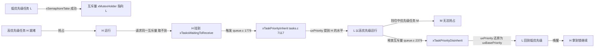
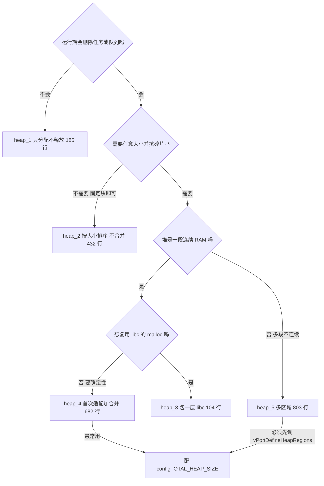
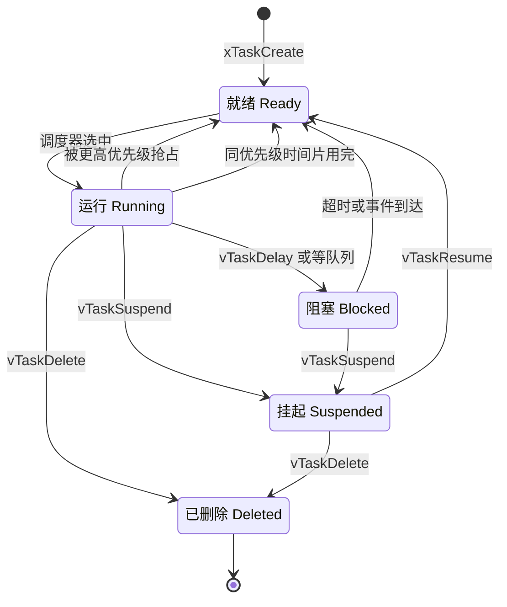

# FreeRTOS 源码详解 03：常见设计模式与陷阱

> **涉及文件（真实路径，行号以本仓库为准）：**
> - `tasks.c`（9398 行）：通知 `xTaskGenericNotify`（8426）、优先级继承（7117）、状态查询（2731）、延时三兄弟（2530 / 2582 / 2680）
> - `queue.c`（3369 行）：阻塞取（1759）、`prvCopyDataToQueue`（2361）
> - `include/stack_macros.h`（150 行）、`include/semphr.h`（1095 行）
> - `portable/MemMang/heap_1.c` ~ `heap_5.c`
> - `portable/GCC/ARM_CM4F/portmacro.h`（272 行，中断延迟的上限由它决定）
>
> **版本基准：** `History.txt` 第 3 行为 V11.3.0 → V11.3.1（2026-08），`include/FreeRTOS.h` 第 2 行为 `<DEVELOPMENT BRANCH>`。本仓库源码已插入中文注释，行号与上游不同。
>
> **姊妹篇：** [01-配置项全景.md](01-配置项全景.md)（这些模式依赖的宏）、[02-移植层要点.md](02-移植层要点.md)（BASEPRI 与中断延迟的硬件细节）。
>
> **KB 对照：** [event_groups_vs_queue.md](../../../05-学习笔记与知识库/Knowledge-Base/freertos/event_groups_vs_queue.md)（同步机制横向选型）、[semphr.md](../../../05-学习笔记与知识库/Knowledge-Base/freertos/semphr.md)（优先级继承逐行）、[heap.md](../../../05-学习笔记与知识库/Knowledge-Base/freertos/heap.md)（五种堆的算法细节）、[task_notification.md](../../../05-学习笔记与知识库/Knowledge-Base/freertos/task_notification.md)（通知的三种模式）。

---

## 1. ISR 安全 API：后缀不是装饰

规则只有一条：**在中断里只能调名字带 `FromISR` 的函数**。这不是命名习惯，而是两套不同的实现——任务版可能阻塞、会改调度器状态，ISR 版不允许阻塞、只置"需要切换"标志。

| 场景 | 任务上下文 | ISR 上下文 | 备注 |
|---|---|---|---|
| 队列发送 | `xQueueSend` | `xQueueSendFromISR` | ISR 版无超时参数，满了直接失败 |
| 队列接收 | `xQueueReceive` | `xQueueReceiveFromISR` | 同上 |
| 二值/计数信号量给 | `xSemaphoreGive` | `xSemaphoreGiveFromISR` | 宏映射到 `xQueueGiveFromISR`（`semphr.h:598`） |
| 二值/计数信号量取 | `xSemaphoreTake` | `xSemaphoreTakeFromISR` | ISR 里通常只给不取 |
| **互斥量给/取** | `xSemaphoreTake` / `Give` | **不存在** | 互斥量有"持有者"概念，ISR 没有任务身份，无法继承优先级 |
| 事件组置位 | `xEventGroupSetBits` | `xEventGroupSetBitsFromISR` | **不直接置位**，见 1.1 |
| 任务通知 | `xTaskNotify` | `xTaskNotifyFromISR` | 另有 `vTaskNotifyGiveFromISR` |
| 读系统时间 | `xTaskGetTickCount` | `xTaskGetTickCountFromISR` | 32 位节拍时两者等价 |
| 软件定时器启停 | `xTimerStart` | `xTimerStartFromISR` | 本质是往定时器命令队列投递 |
| 延时/阻塞 | `vTaskDelay` | **不存在** | ISR 不能阻塞 |
| 创建/删除对象 | `xTaskCreate` / `vTaskDelete` | **不存在** | 会动堆和链表 |
| 进入临界区 | `taskENTER_CRITICAL` | `taskENTER_CRITICAL_FROM_ISR` | 后者返回旧 BASEPRI，必须配对恢复 |

每个 `FromISR` API 入口都会调 `portASSERT_IF_INTERRUPT_PRIORITY_INVALID()`（`portmacro.h:183`），最终落到 `vPortValidateInterruptPriority`（`port.c:919`）。**表里"不存在"的那几行，编译器帮你挡住了；表里存在但优先级配错的行，只有这个断言能挡住。**

### 1.1 一个反直觉的例子：`xEventGroupSetBitsFromISR` 不置位

`event_groups.c:857-871`：

```c
            xReturn = xTimerPendFunctionCallFromISR( &vEventGroupSetBitsCallback, ( void * ) xEventGroup, ( uint32_t ) uxBitsToSet, pxHigherPriorityTaskWoken );
```

它把"置位"这件事**打包成一个函数调用，投递给定时器守护任务**，等守护任务被调度时才真正执行。原因：置位要遍历等待链表、可能唤醒多个任务，这套逻辑太长，不适合放在 ISR 里。

**三个后果：**

1. 必须 `configUSE_TIMERS = 1` 且 `INCLUDE_xTimerPendFunctionCall = 1`，否则这个 API 根本不存在（`event_groups.c:873` 的条件编译）。
2. 从 ISR 到"位真的被置上"有一个**任务调度延迟**，不是即时的。
3. 守护任务优先级若低于你的消费者任务，延迟会更大。

**所以：ISR 里要"立刻"唤醒一个任务，用任务通知；要"广播状态"，才用事件组并接受这个延迟。**

---

## 2. 临界区长度与中断延迟预算

### 2.1 三种"屏蔽"不是一回事

| 手段 | 屏蔽什么 | 中断延迟 | 调度延迟 | 典型用途 |
|---|---|---|---|---|
| `taskENTER_CRITICAL`（BASEPRI） | 优先级数值 ≥ 阈值的中断 | **有**，等于临界区长度 | 有 | 改链表、改计数器 |
| `vTaskSuspendAll` | 不屏蔽任何中断，只禁止任务切换 | **无** | 有，等于挂起时长 | 长操作、调 `pvPortMalloc` |
| `cpsid i`（PRIMASK） | 全部中断 | 有，且不可收敛 | 有 | FreeRTOS 内核不用 |

**最常见的错误是用第一种去做第三种的事。** 在临界区里调 `printf`、等 Flash 写入、跑 `memcpy` 大块数据，都会把"最长临界区"从 0.5 µs 拉到毫秒级，所有中优先级中断一起遭殃。

### 2.2 一次队列发送的临界区有多长

`queue.c:962-970` 的发送路径，临界区内做的事：

```c
        taskENTER_CRITICAL();
        {
            /*
             * 此时队列中是否有空闲空间？正在运行的任务必定是希望访问该队列的最高优先级任务。如果要覆盖队列头部的消息项，则队列是否已满无关紧要。
             */
            if( ( pxQueue->uxMessagesWaiting < pxQueue->uxLength ) || ( xCopyPosition == queueOVERWRITE ) )
            {
                traceQUEUE_SEND( pxQueue );
```

| 步骤 | 周期（168 MHz 量级） |
|---|---|
| `msr basepri` + `isb` + `dsb` | 8~12 |
| 读 `uxMessagesWaiting`、`uxLength`、比较 | 4~6 |
| `memcpy` 一个 4 字节消息项 | 4~8 |
| `pcWriteTo` 指针推进 + 回绕判断 | 4~6 |
| 恢复 BASEPRI | 2~3 |
| **合计** | **约 25~40 周期 ≈ 0.15~0.25 µs** |

**注意：** 上面不含 `prvCopyDataToQueue` 里的互斥量分支（`queue.c:2372-2388`），那是 O(1) 的两次赋值，可忽略。也不含队列满时的阻塞路径——那条路径会 `vTaskSuspendAll` + 改事件链表，**不在临界区里**，所以不增加中断延迟。

### 2.3 预算表

设 `configMAX_SYSCALL_INTERRUPT_PRIORITY = 0x50`（可被屏蔽的最低档），则被屏蔽中断的最坏延迟：

```text
最坏延迟 = 最长临界区 + 中断入口开销 + 可能排队的前一个临界区
         ≈ 0.25 µs + 0.1 µs + 0.25 µs ≈ 0.6 µs
```

| 目标最坏延迟 | 允许的最长临界区 | 能做到吗 |
|---|---|---|
| < 1 µs | < 0.5 µs | 可以，只做指针/计数器操作 |
| 1~5 µs | < 4 µs | 可以，队列收发、链表遍历 |
| 5~20 µs | < 15 µs | 勉强，禁止 `memcpy` 大结构 |
| > 20 µs | — | 说明该操作不该在临界区里 |

**如果某个中断的要求严于 1 µs，正确做法不是缩短临界区，而是把它的优先级设到阈值之上（数值更小）。** 代价：它不能调用任何 FreeRTOS API（见 02 篇第 7 节）。

---

## 3. 优先级反转与优先级继承

### 3.1 三个任务的经典剧本

| 时刻 | 事件 | 谁在跑 |
|---|---|---|
| T0 | 低优先级 L 拿到互斥量 M | L |
| T1 | 高优先级 H 就绪，抢占 L | H |
| T2 | H 请求 M，阻塞 | L（但被 M 挡不住的中优先级 M 抢了） |
| T3 | 中优先级 M 就绪，抢占 L | M |
| T4 | H 在等 L，L 在等 CPU，M 在跑 | **M** |

H 的实际等待时间 = L 的剩余临界区 + **M 的整个执行时间**。M 与 M 毫无关系，却决定了 H 的延迟——这就是优先级反转。若 M 是个长任务，H 可能错过死线。

### 3.2 继承发生在"取不到"的那一刻

`queue.c:1772-1781`：

```c
                #if ( configUSE_MUTEXES == 1 )
                {
                    if( pxQueue->uxQueueType == queueQUEUE_IS_MUTEX )
                    {
                        taskENTER_CRITICAL();
                        {
                            xInheritanceOccurred = xTaskPriorityInherit( pxQueue->u.xSemaphore.xMutexHolder );
                        }
                        taskEXIT_CRITICAL();
                    }
```

**两个条件缺一不可：** 队列类型是 `queueQUEUE_IS_MUTEX`，且取不到（`prvIsQueueEmpty` 为真、且还有剩余阻塞时间）。二值信号量走同一段代码但类型不是 mutex，**不会继承**——这是"信号量不能替代互斥量"的根本原因。

### 3.3 继承做了什么

`tasks.c:7168-7169`：

```c
                    /* 在移入新链表之前继承优先级。 */
                    pxMutexHolderTCB->uxPriority = pxCurrentTCB->uxPriority;
                    prvAddTaskToReadyList( pxMutexHolderTCB );
```

三件事：把持有者的 `uxPriority` 提到请求者水平、把它从旧优先级就绪链表摘下（`tasks.c:7154` 的 `uxListRemove`）、挂到新优先级链表。**`uxBasePriority` 不动**（`tasks.c:465`），所以释放时能原样还原。

### 3.4 释放时的还原

`queue.c:2372-2380`：

```c
    if( pxQueue->uxItemSize == ( UBaseType_t ) 0 )
    {
        #if ( configUSE_MUTEXES == 1 )
        {
            if( pxQueue->uxQueueType == queueQUEUE_IS_MUTEX )
            {
                /* 该互斥量不再被持有。 */
                xReturn = xTaskPriorityDisinherit( pxQueue->u.xSemaphore.xMutexHolder );
                pxQueue->u.xSemaphore.xMutexHolder = NULL;
```

`xTaskPriorityDisinherit`（`tasks.c:7226`）把 `uxPriority` 恢复成 `uxBasePriority`，如果恢复后仍是就绪态最高，返回值让调用方立刻让出 CPU——**否则 H 已经就绪却要等到下一个 tick 才跑**。

### 3.5 数据流



**读图要点：** 继承不是"提高 L 的地位"，而是"让 L 尽快跑完临界区"。所以提升只在 `pxMutexHolderTCB->uxPriority < pxCurrentTCB->uxPriority` 时发生（`tasks.c:7134`）——L 已经比 H 高就不用提。

### 3.6 继承解决不了的三件事

**死锁**（两个任务以相反顺序拿两把锁）继承帮不上，唯一解法是全局锁顺序；**优先级天花板**FreeRTOS 没有实现，最高优先级任务的阻塞上界仍取决于"临界区长度 × 锁链长度"；**中断里的锁**也没有——ISR 不能持有互斥量（没有任务身份），与任务共享数据只能用临界区或队列/通知。

---

## 4. 栈溢出检测：两种方法，各有盲区

配置 `configCHECK_FOR_STACK_OVERFLOW`（默认 0，`FreeRTOS.h:730`）。检测点在 `vTaskSwitchContext`（`tasks.c:5576`）：**每次任务切出时检查一次**。

### 4.1 方法一：比栈顶指针（`stack_macros.h:62-76`）

```c
    #define taskCHECK_FOR_STACK_OVERFLOW()                                                      \
    do                                                                                          \
    {                                                                                           \
        /* Is the currently saved stack pointer within the stack limit? */                      \
        if( pxCurrentTCB->pxTopOfStack <= pxCurrentTCB->pxStack + portSTACK_LIMIT_PADDING )     \
        {                                                                                       \
            char * pcOverflowTaskName = pxCurrentTCB->pcTaskName;                               \
            vApplicationStackOverflowHook( ( TaskHandle_t ) pxCurrentTCB, pcOverflowTaskName ); \
        }                                                                                       \
    } while( 0 )
```

**成本：** 一次比较 + 一次加法，约 4 个周期。**盲区：** 只能发现"栈指针已经越界"，如果溢出后又被弹回合法范围（写到低地址的全局变量上再恢复），完全抓不到。

### 4.2 方法二：查栈尾魔数（`stack_macros.h:96-115`）

判据是四个比较（`stack_macros.h:105-108`）：`( pulStack[ 0 ] != ulCheckValue )`、`[ 1 ]`、`[ 2 ]`、`[ 3 ]`，任一为真就报溢出；`ulCheckValue` 在 `stack_macros.h:102` 定义为 `( uint32_t ) 0xa5a5a5a5U`。

`0xa5` 是任务创建时填满整个栈的（`tasks.c:160` 定义 `tskSTACK_FILL_BYTE`，`tasks.c:1966` 的 `memset`）。检测就是看**最低 4 个字**有没有被改写。

**盲区：** 只查 4 个字 = 16 字节。如果一次压栈跨过这 16 字节、直接写到更低的地址，图案仍完好。所以方法二**也不能保证**抓到。

| | 方法一 | 方法二 |
|---|---|---|
| 判断依据 | `pxTopOfStack <= pxStack` | 栈尾 4 个字的魔数 |
| 成本 | ~4 周期 | ~8 周期（4 次比较） |
| 能抓 | 切出瞬间已越界 | 越界写发生过（只要碰到栈尾 16 B） |
| 抓不到 | 越界后又恢复 | 跨过 16 B 直接写更远 |
| 适用 | 快速迭代期 | 发布前验证期 |

### 4.3 真正可靠的三个补充手段

1. **栈水位**：`uxTaskGetStackHighWaterMark`（`tasks.c:6837` 从栈尾往上数连续的 `0xa5`）。它告诉你"历史最深用到哪"，比溢出钩子有用——**因为你可以在没溢出时就发现余量不足**。
2. **静态分配 + MPU**：Cortex-M4F 的 MPU 端口可以把栈设成不可写保护区，越界立即 MemManage Fault。本移植层（`port.c`）不支持，需要换 `portable/GCC/ARM_CM4_MPU`。
3. **栈尾哨兵 + 定期巡检**：在 `vApplicationIdleHook` 里检查所有任务的栈尾，比"切出时检查"覆盖更全（能抓到"任务运行中溢出、但还没切出"的情况）。

---

## 5. heap_1 ~ heap_5 决策树

| 方案 | 行数 | 能释放 | 合并相邻块 | 确定性 | 典型场景 |
|---|---|---|---|---|---|
| `heap_1` | 185 | **否**（`vPortFree` 直接断言，`heap_1.c:149-160`） | — | 最高 | 所有对象在启动时创建、永不删除 |
| `heap_2` | 432 | 是 | **否** | 高 | 固定大小块反复申请释放 |
| `heap_3` | 104 | 是 | 交给 libc | 低（libc 决定） | 已有成熟 libc 堆、想要 `free` 的全部能力 |
| `heap_4` | 682 | 是 | **是**（双向合并） | 高 | 通用首选 |
| `heap_5` | 803 | 是 | 是 | 高 | RAM 不连续（内部 SRAM + 外部 SDRAM） |



**读图要点：**

- 决策的第一问不是"要不要释放"，而是"**运行期会不会删对象**"。绝大多数固件在 `main` 里建完所有任务/队列就不再创建，这种场景 `heap_1` 最省心：没有碎片、没有锁、分配就是指针加法。
- `heap_3` 的唯一优势是"能拿到 libc 的全部能力"，代价是**失去确定性**（libc 的分配策略不在你控制内）且依赖链接脚本给出堆区。
- `heap_5` 的 `vPortDefineHeapRegions` **必须在任何 `pvPortMalloc` 之前调用**（`heap_5.c:38-40` 的注释用 `***必须***` 强调），而 `xTaskCreate` 内部就会调 `pvPortMalloc`——所以它得是 `main` 的第一行。

**量化（Cortex-M4F，8 字节对齐）：**

| 项 | 字节 |
|---|---|
| 每块头部 `BlockLink_t`（`heap_4.c:161` 的 `xHeapStructSize`） | 8 |
| `heap_4` 最小块 `heapMINIMUM_BLOCK_SIZE`（`heap_4.c:59`，两个头部） | 16 |
| 一次 `pvPortMalloc(100)` 实占 | 108 |

所以 `configTOTAL_HEAP_SIZE = 4096` 时，实际可用 ≈ 4096 − 8（首部对齐损耗）− 每块 8 B 头。**申请 100 B 的块，堆里少 108 B**；50 个小对象就是 400 B 的纯开销。

---

## 6. `vTaskDelay` vs `vTaskDelayUntil`

### 6.1 相对延时：从"现在"开始算

`tasks.c:2686-2701`：

```c
        /* 延时时间为 0 只会强制重新调度。 */
        if( xTicksToDelay > ( TickType_t ) 0U )
        {
            vTaskSuspendAll();
            {
                configASSERT( uxSchedulerSuspended == 1U );

                traceTASK_DELAY();

                /*
                 * 在调度器挂起期间从事件链表中移除的任务，在调度器恢复之前
                 * 既不会被放入就绪链表，也不会从阻塞链表中移除。
                 *
                 * 当前正在执行的任务不可能位于事件链表中。
                 */
                prvAddCurrentTaskToDelayedList( xTicksToDelay, pdFALSE );
            }
            xAlreadyYielded = xTaskResumeAll();
        }
```

关键在 `prvAddCurrentTaskToDelayedList( xTicksToDelay, ... )`：它把**当前 tick + 延时**写进延时链表。所以周期 = 延时 + 本次循环的执行时间。

**漂移量化：** 目标 100 Hz（10 ms），循环体耗时 3 ms：

```text
vTaskDelay(10) 的实际周期 = 3 ms + 10 ms = 13 ms → 76.9 Hz，误差 30%
一小时后累计漂移 = 3600 s × (13 - 10) / 13 ≈ 831 s ≈ 13.8 分钟
```

### 6.2 绝对延时：从"上次唤醒点"开始算

`tasks.c:2602-2614`：

```c
            /* 计算任务期望唤醒的节拍时间。 */
            xTimeToWake = *pxPreviousWakeTime + xTimeIncrement;

            if( xConstTickCount < *pxPreviousWakeTime )
            {
                /*
                 * 自上次调用此函数以来节拍计数已溢出。此时，只有当唤醒时间也溢出
                 * 且唤醒时间大于节拍计数时才应真正延时。在这种情况下，
                 * 就如同两个时间都未溢出一样。
                 */
                if( ( xTimeToWake < *pxPreviousWakeTime ) && ( xTimeToWake > xConstTickCount ) )
                {
                    xShouldDelay = pdTRUE;
                }
```

`xTimeToWake` 由**上次的唤醒时刻**推出，与本次执行时间无关，所以周期严格等于 `xTimeIncrement`。两个 `if` 分支专门处理 `TickType_t` 回绕（32 位 tick 在 1000 Hz 下 49.7 天回绕一次）。

**代价：** 如果循环体偶发超时（执行时间 > 周期），`xTaskDelayUntil` 会返回 `pdFALSE` 并且**不延时**（`xShouldDelay` 保持 `pdFALSE`），任务连轴转追赶，`*pxPreviousWakeTime` 会一路落后——这就是"runaway"。

### 6.3 V11.3.1 的新选择：`xTaskPeriodicDelay`

`tasks.c:2543-2558` 里，`xIncrements = xTicksElapsed / xTimeIncrement` 算出"错过了几个周期"，`*pxPreviousWakeTime += xTicksIncrements` 按整数个周期前推，`xTicksToWait = xTimeIncrement - ( xTicksElapsed - xTicksIncrements )` 得到距下次唤醒的节拍数。`History.txt:11` 称它 "supersedes xTaskDelayUntil by preventing run away of pxPreviousWakeTime"。

| API | 周期基准 | 超时后行为 | 返回 |
|---|---|---|---|
| `vTaskDelay` | 现在 | 自然顺延 | 无 |
| `xTaskDelayUntil` | 上次唤醒点 | 不延时、追赶、可能 runaway | `pdTRUE` 表示真的延时了 |
| `xTaskPeriodicDelay` | 上次唤醒点按周期对齐 | 跳过错过的周期、不 runaway | 错过/经过的周期数 |

**选型：** 采样、控制环用 `xTaskPeriodicDelay`（或 `xTaskDelayUntil`）；"等一会儿"用 `vTaskDelay`；两者都不要用来做**精确**时间戳，那是硬件定时器的活。

---

## 7. 队列 vs 任务通知

### 7.1 内存成本

| | 队列 | 任务通知 |
|---|---|---|
| 控制块 | `Queue_t` 约 72 B（含 2 个 `List_t`） | 0 B（复用 TCB 字段） |
| 每条数据 | `uxItemSize` 字节 × `uxLength` | 0 B（值存在 TCB 里） |
| 每任务固定开销 | — | `ulNotifiedValue[]` 4 B + `ucNotifyState[]` 1 B 每索引（`tasks.c:486-487`） |
| 多生产者 | 天然支持 | 支持（都指向同一个 TCB） |
| 缓冲 N 条 | 支持 | 只有 1 个值（或 32 位位图） |

`Queue_t` 的成员见 `queue.c:115-148`：2 个指针 + 1 个 union（8 B）+ 2 个 `List_t`（40 B）+ 3 个 `UBaseType_t`（12 B）+ 2 个 `int8_t` 锁计数 + 1 个分配标志 ≈ **71 B → 对齐后 72 B**。10 个队列 = 720 B 纯控制块开销，还没算数据区。

### 7.2 发送路径对比

队列（`queue.c:962-970`）：进临界区 → 判满 → `memcpy` 数据 → 推进写指针 → 判回绕 → 看是否有等待接收者 → 可能要唤醒。**数据要被复制一次。**

通知（`tasks.c:8451-8461`，整段在 `taskENTER_CRITICAL` 之内）：

```c
            pxTCB->ucNotifyState[ uxIndexToNotify ] = taskNOTIFICATION_RECEIVED;

            switch( eAction )
            {
                case eSetBits:
                    pxTCB->ulNotifiedValue[ uxIndexToNotify ] |= ulValue;
                    break;

                case eIncrement:
                    ( pxTCB->ulNotifiedValue[ uxIndexToNotify ] )++;
                    break;
```

**没有 memcpy、没有队列对象、没有链表插入**（除非接收者正在阻塞，见 `tasks.c:8504-8507` 才做 `listREMOVE_ITEM` + `prvAddTaskToReadyList`）。

| 项 | 队列 | 通知 |
|---|---|---|
| 发送指令数（量级） | 30~50 | 15~25 |
| 168 MHz 下耗时 | 0.2~0.3 µs | 0.1~0.15 µs |
| 数据复制 | 有 | 无（4 字节以内） |
| 需要目标 TCB | 否 | **是**（必须知道发给谁） |

**这就是"通知快一倍"的由来，也是它的限制：通知是"点对点"的，队列是"对象"的。** 一个 ISR 要发给"当前活跃的消费者"（可能是 3 个任务中的任意一个），通知做不到，必须用队列。

### 7.3 选型规则

| 需求 | 选 |
|---|---|
| ISR 发一个 32 位以内的值给**确定的一个任务** | 任务通知 |
| 多生产者 → 单消费者，需要缓冲 N 条 | 队列 |
| 传递结构体 / 字符串 / 大于 4 字节 | 队列（或消息缓冲） |
| 需要一个"对象"被多个任务引用、可删除 | 队列 |
| 二值事件、计数值 | 通知（`vTaskNotifyGiveFromISR`）或二值信号量 |
| 需要"广播状态给多个任务" | 事件组 |
| 字节流（串口/UDP） | 流缓冲 / 消息缓冲 |

**性能陷阱：** 有人为了"省一个队列"把结构体指针用通知传——**指针指向的缓冲区所有权没解决**，发送方复用缓冲区时接收方还在读，这是比性能更严重的 bug。通知只适合传**值**。

---

## 8. 任务状态迁移

`eTaskGetState`（`tasks.c:2731-2862`）用"任务在哪个链表里"反推状态：

| 判定条件（行号） | 状态 |
|---|---|
| `pxTCB == pxCurrentTCB`（2745） | `eRunning` |
| 事件项在 `xPendingReadyList`（2762） | `eReady` |
| 状态项在 `pxDelayedTaskList` / 溢出表（2770） | `eBlocked` |
| 状态项在 `xSuspendedTaskList` 且事件项为空（2779-2795） | `eSuspended`（若在等通知则是 `eBlocked`，2799-2802） |
| 状态项在 `xTasksWaitingTermination` 或为空（2820） | `eDeleted` |
| 其余（2829-2837） | `eReady` |



**读图要点：**

- **所有阻塞入口只有两个**：`prvAddCurrentTaskToDelayedList`（`tasks.c:9106`）和 `vTaskPlaceOnEventList`，它们分别把任务挂到延时表/事件表。所以"阻塞"在链表层面就是"进了某张表"。
- **`vTaskSuspend` 可从任意状态进入**，被挂起的任务**不会**因超时自动恢复——`xSuspendedTaskList` 与延时表是两张表。
- **"无限期阻塞"与"挂起"在链表上长得一样**：都在 `xSuspendedTaskList`，区别是事件项是否为空、通知状态是否为 `taskWAITING_NOTIFICATION`（`tasks.c:2785-2804`）。这就是 `INCLUDE_vTaskSuspend = 0` 时 `portMAX_DELAY` 语义会变的原因。
- **`eDeleted` 是"已删除但 TCB 未回收"**：自删时 TCB 进 `xTasksWaitingTermination`，等 idle 任务回收（`tasks.c:2497-2500`）。

---

## 9. 陷阱与实测建议

1. **`xEventGroupSetBitsFromISR` 依赖定时器守护任务。** 关掉 `configUSE_TIMERS` 后它整个消失（`event_groups.c:873`）；打开但守护任务优先级太低时，ISR 到任务唤醒之间会插入一段不确定延迟。
2. **互斥量不能在 ISR 里给。** `semphr.h:377` 明说 `xSemaphoreGive` 不得在 ISR 中使用；而"互斥量的 ISR 版"根本不存在，因为继承需要任务身份。ISR 与任务共享资源，用临界区或队列。
3. **优先级继承只在"取不到"时触发（`queue.c:1768-1778`）。** 如果 H 每次都能立刻拿到锁（L 刚好没持有），继承从不发生，你也就看不到它的开销——但这不代表没有反转风险，只是没触发。
4. **`configCHECK_FOR_STACK_OVERFLOW = 2` 只查 4 个字（`stack_macros.h:104-108`）。** 大结构体一次压栈跨过 16 B 时抓不到。**必须配合 `uxTaskGetStackHighWaterMark` 定期巡检**，别把它当保险。
5. **`heap_1` 的 `vPortFree` 会断言 `pv == NULL`（`heap_1.c:159`）。** 传非空指针直接进 `configASSERT`；如果断言关了，它**什么也不做**，内存永远不回收。
6. **`heap_5` 的初始化顺序是硬约束。** `vPortDefineHeapRegions` 必须在**任何**对象创建之前调用（`heap_5.c:38-40`），而 `xTaskCreate` 内部就会分配——顺序错了表现为第一次 `pvPortMalloc` 拿到 NULL。
7. **`xTaskDelayUntil` 超时会 runaway。** 循环体偶发超时后 `*pxPreviousWakeTime` 停在旧值，后续每次调用都"已经迟了"，任务连轴转。V11.3.1 的 `xTaskPeriodicDelay` 就是修这个的（`tasks.c:2551-2555`）。
8. **任务通知的值是"最后一次写赢"。** `eSetValueWithOverwrite` 会覆盖未读的值，`eIncrement` 只加计数不保数据。**要保序、要保数据，用队列。**
9. **`vTaskSuspend` 挂起的任务不会因超时恢复。** 一个"等队列 100 ms"的任务被挂起后，队列来了数据也不会被唤醒——`xSuspendedTaskList` 与延时表是两张表，恢复只能靠 `vTaskResume`。
10. **临界区里不要调 `pvPortMalloc`。** `heap_4` 的分配本身就要遍历空闲链表（`heap_4.c:178` 起），在临界区里做等于把最长临界区交给堆的碎片程度决定——碎片多时是毫秒级。

**实测建议（按顺序做）：**

```text
1. 先量"最长临界区"：GPIO 在 taskENTER_CRITICAL 前后翻转，示波器看最宽脉冲
2. 再量"中断延迟"：GPIO 在 ISR 入口翻转，与中断源信号对比
3. 用 uxTaskGetStackHighWaterMark 采集一周，栈按 1.3 倍余量重定
4. 用 uxTaskGetSystemState 看 CPU 占比，idle < 10% 说明有任务在忙等
5. 压测队列：故意让生产快于消费，看 uxMessagesWaiting 是否长期贴满
6. 只有在确认瓶颈后才把队列换通知，换完必须重测最坏路径
```

> 这些模式依赖的宏怎么配见 [01-配置项全景.md](01-配置项全景.md)；BASEPRI 与中断延迟的硬件原理见 [02-移植层要点.md](02-移植层要点.md)。
